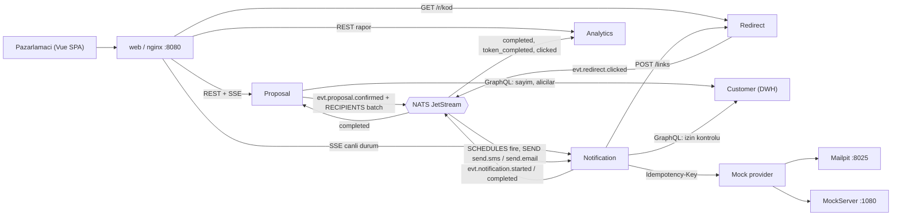

# Smart Campaign Composer

Pazarlamacı kampanya isteğini doğal dille yazar. Claude brief'ten bir segment kuralı, kanal planı, dil × kanal başına mesaj metni ve (dil, saat dilimi) başına gönderim zamanı önerir; her adımı insan önizler, gerekirse düzenler ve onaylar. Onaydan sonra mesajlar kuyruk üzerinden kanal başına saniyede 100 mesaj hızıyla mock provider'a gider; gönderim canlı izlenir, tıklamalar ve LLM maliyeti analitikte toplanır. Gerçek kimseye mesaj gitmez: alıcılar 3000 sahte kullanıcıdır, e-postalar Mailpit'e, SMS'ler MockServer'a düşer.

Backend Go (6 servis), frontend Vue 3 + TypeScript, LLM Claude API (`anthropic-sdk-go`), veritabanı Postgres 18, kuyruk NATS JetStream. Kararların tamamı [DECISIONS.md](DECISIONS.md), veri modeli ve olay sözleşmeleri [docs/domain-model.md](docs/domain-model.md) içindedir.

## Kurulum ve çalıştırma

**Gereksinimler:** Docker (Compose v2). Testleri yerelde koşmak için ayrıca Go 1.27 (`go.mod`), Node 24 ve pnpm 12.8.1 (`web/Dockerfile`, `.github/workflows/test.yml`).

```bash
cp .env.example .env     # ANTHROPIC_API_KEY isteğe bağlı
docker compose up -d
```

`ANTHROPIC_API_KEY` boş bırakılabilir. `LLM_MODE` (D-072) seçimi:

| `LLM_MODE` | Davranış |
|---|---|
| `auto` (varsayılan) | Anahtar doluysa gerçek model, boşsa yerleşik mock |
| `anthropic` | Her zaman gerçek model; anahtar yoksa servis başlamaz |
| `mock` | Her zaman mock: örnek brief ve seed'deki geçmiş kampanya brief'leri için elle yazılmış yanıtlar, bilinmeyen brief'te `[mock]` işaretli varsayılan içerik |

Seçilen mod `proposal` servisinin `/readyz` çıktısında görünür. Gerçek modeller: segment ve metin `claude-sonnet-5-5`, ön eleme, kanal planı ve zamanlama `claude-haiku-5-5` (D-026, D-070).

**Ne başlar:** tek Postgres (servis başına veritabanı), NATS JetStream, tek seferlik `nats-init` (stream tanımları `infra/nats/streams/`), altı Go servisi, Mailpit, MockServer ve nginx tabanlı `web` gateway. Host portları (`.env` ile değiştirilebilir):

| Servis | Host portu | Not |
|---|---|---|
| `web` | 8080 | SPA + `/api/<servis>/` gateway + `/r/<kod>` kısa linkler |
| `proposal` | 8081 | Kampanya, teklif adımları, LLM çağrıları |
| `notification` | 8082 | Zamanlama, kuyruk, gönderim, canlı durum |
| `analytics` | 8083 | Özet, CTR, LLM kullanımı ve maliyeti |
| `mockprovider` | 8084 | Sahte SMS/e-posta sağlayıcısı |
| `redirect` | 8085 | İmzalı kısa link ve tıklama |
| `customer` | — | Yalnız compose ağı; GraphQL, dışarı açılmaz (D-043) |
| `postgres` | 5433 | |
| `nats` | 4222 / 8222 | İstemci / monitoring (`http://localhost:8222`) |
| `mailpit` | 8025 | E-posta gelen kutusu |
| `mockserver` | 1080 | SMS gelen kutusu |

**Adresler:**

- Uygulama: `http://localhost:8080`
- API belgeleri (Scalar): `http://localhost:8081/docs`, `:8082/docs`, `:8083/docs`, `:8084/docs`, `:8085/docs`; ham spec `/openapi.json` (D-057, `API_DOCS_ENABLED`)
- Mailpit: `http://localhost:8025`
- MockServer dashboard: `http://localhost:1080/mockserver/dashboard`
- Her Go servisinde `/healthz`, `/readyz`, `/metrics` (Prometheus) (D-050)

**Seed:** `stub/` altındaki 3000 kullanıcılık sahte veri (ad, e-posta, telefon, şehir, dil, saat dilimi, sipariş, sepet, olay ve kanal izinleri; D-113, ayrıntı [stub/README.md](stub/README.md)) Postgres init script'leriyle yalnız **boş volume'a** yüklenir (D-005). Seed'i veya şemayı yeniden yüklemek için volume'ların silinmesi gerekir: `docker compose down -v && docker compose up -d`. Bu komut tüm kampanya verisini de siler.

## Kısa demo akışı

Örnek brief (CLAUDE.md):

> Son 30 günde sepetine ürün ekleyip alışveriş yapmayan İstanbul'daki kullanıcılara %30 indirim hatırlatması gönder. Samimi ama kısa olsun.

1. `http://localhost:8080` açılır; sol üstte logonun yanındaki **+** ile yeni sohbet başlar, brief yazılır.
2. **Kitle:** brief önce Haiku ile prompt enjeksiyonuna karşı elenir, sonra segment kuralı (DSL) üretilir, backend'de doğrulanıp Customer GraphQL'e çevrilir. Ekranda kişi sayısı, dil ve kanal kapsaması (hem e-posta hem SMS / yalnız biri / ulaşılamaz) görünür. Seed'le örnek brief 155 kişiyle eşleşir; bunların 138'ine en az bir kanaldan ulaşılabilir (85 iki kanal, 35 yalnız e-posta, 18 yalnız SMS; 17 ulaşılamaz).
3. **Kanal planı:** tek kanal, birincil + yedek veya ikisi birden; alıcı sayıları kanal başına gösterilir. Onay.
4. **Metin:** kitledeki her dil × plandaki her kanal için ayrı varyant ekrana stream edilir. SMS en fazla 160 karakter (izleme linki dahil; metin bütçesi `160 − link`, varsayılanda 125), kodlama (GSM-7 / UCS-2) ve segment sayısı gösterilir; e-posta konusu en fazla 80 karakter, HTML önizlemesi vardır. `{{first_name}}` desteklenir. SMS ve e-posta kartta düzenlenebilir; düzenleme de aynı sunucu doğrulamasından geçer. Beğenilmeyen varyant gerekçeyle reddedilip yeniden üretilir.
5. **Zamanlama:** kitledeki her (dil, saat dilimi) çifti için ayrı gönderim zamanı önerilir; saat seçici o yuvanın saat dilimindedir, "hemen gönder" seçeneği vardır (D-076, D-119). Onay kampanyayı Notification'a devreder.
6. **Canlı gönderim:** **Analitikler → Canlı gönderim** altında kanal ve durum (`pending`, `sending`, `sent`, `failed`, `skipped_no_consent`) sayıları SSE ile anlık güncellenir.
7. **Sonuç:** e-postalar `http://localhost:8025` (Mailpit), SMS'ler `http://localhost:1080/mockserver/dashboard` (MockServer, `POST /sms` istekleri) üzerinde görülür. Bir mesajdaki `/r/<kod>` linkine tıklamak Analytics'te tıklama ve CTR olarak **Kampanya analitiği** ekranına düşer; **LLM analitiği** çağrı, token ve maliyeti prompt sürümüne göre listeler.

## Testler

```bash
make test        # Go birim + entegrasyon (testcontainers: Docker gerekir) ve web (Vitest)
make test-go     # yalnız Go, -tags=integration
make test-unit   # Docker'sız: Go birim testleri + web
make test-web    # yalnız web (pnpm -C web test:unit)
make eval        # prompt değerlendirmesi (D-115)
make coverage    # birim test kapsamı, rapor coverage/ altında
```

- Entegrasyon testleri `integration` build tag'ini taşır ve testcontainers-go ile Postgres 18 + NATS başlatır (D-025, D-051). Paket paralelliği `-p 2` ile sınırlıdır; `GO_TEST_P` ile değişir (D-098).
- Hiçbir test gerçek API anahtarı okumaz: LLM senaryolu bir sahte ile, gönderim `MOCK_SEED`'li gerçek mock provider handler'ıyla sınanır (D-025, D-103). Örnek brief'in uçtan uca zinciri tek süreçte, tüm servislerle çalışan bir Go testiyle kanıtlanır (`internal/e2e`, D-102).
- `make eval`: `eval/cases/*.json` içindeki elle yazılmış model yanıtları gerçek doğrulama hattından geçer, vaka başına bir satır basar, uyumsuzlukta sıfırdan farklı çıkar. `make test`'in parçası değildir. Ayrıntı [eval/README.md](eval/README.md).
- CI: [.github/workflows/test.yml](.github/workflows/test.yml) her push ve pull request'te `make test` ve ardından `make eval` koşar; secret yoktur (D-105).

## Mimari

Altı Go servisi tek modülde (`cmd/<servis>`, `internal/`), her biri kendi Postgres veritabanı ve rolüyle (D-003, D-021):

- **Customer:** seed'den beslenen filtrelenmiş DWH (`customer_db`, yıldız şema, kart/IBAN hariç) ve GraphQL API: kitle sayımı, alıcı listesi, izin durumu. Dışarı açılmaz; her çağıran kendi bearer token'ı ve kapsamıyla gelir (D-004, D-007, D-063).
- **Proposal:** kampanya ve teklif adımları (`audience → channel_plan → content → schedule`), LLM çağrıları, REST + SSE (D-022, D-072).
- **Notification:** gönderim kampanyası, (dil, saat dilimi) zamanlamaları, teslimat satırları, kuyruk worker'ları, canlı durum SSE'si (D-077, D-079, D-080).
- **Analytics:** kampanya özeti, kanal/durum kırılımı, CTR, LLM kullanımı ve maliyeti (D-083, D-108).
- **Redirect:** SMS ve e-postadaki imzalı kısa linkler, tıklama olayı (D-106, D-107).
- **Mock provider:** `POST /v1/sms` ve `POST /v1/email`; e-postayı Mailpit'e, SMS'i MockServer'a iletir (D-081).
- **web:** Vue build'ini sunan ve `/api/<servis>/` ile `/r/` yollarını yönlendiren tek nginx konteyneri (D-015, D-085).

Servisler arası her şey NATS JetStream üzerindedir ve her olay iş satırıyla aynı transaction'da `outbox` tablosuna yazılıp relay ile yayınlanır; tüketiciler `processed_event` ile tekrarı eler (D-006, D-054). Senkron çağrı yalnız Customer GraphQL'e (sayım, alıcılar, izin) ve Notification → Redirect'e (link üretimi) yapılır. Tarayıcı REST ile konuşur, canlı güncellemeler SSE'dir (D-013).



Stream'ler: `EVENTS` (servisler arası olaylar), `RECIPIENTS` (500'lük alıcı batch'leri), `SCHEDULES` (sunucu tarafı zamanlanmış iletiler), `SEND` (teslimat başına iş). Olay kataloğu ve zarf: [docs/domain-model.md §6](docs/domain-model.md).

**Güvenilirlik noktaları:**

- **Segment kuralı SQL olarak çalışmaz.** LLM yalnız kendi Pratt ayrıştırıcımızla ayrıştırılan bir DSL filtresi yazar; alanlar şemadan üretilen beyaz listeli katalogla sınırlıdır, DSL GraphQL'e çevrilir ve Customer parametreli SQL'e derler (D-038, D-041, D-044, D-062).
- **İzin gönderim anında kontrol edilir.** Worker kanal başına en fazla 100 teslimat için tek `consentStatus` sorgusu atar; izni olmayan `skipped_no_consent` olur, diğer kanala düşürülmez. Customer'a ulaşılamazsa gönderim yapılmaz (fail-closed, circuit breaker) (D-011, D-079).
- **Kanal başına 100 msg/s:** süreç içi `golang.org/x/time/rate` limiter, `rate.NewLimiter(100, 10)` (D-024, D-079).
- **Aynı kişiye aynı mesaj iki kez gitmez:** `UNIQUE (campaign_id, customer_id, channel)`, teslimat id'si = `Idempotency-Key`, mock provider anahtarı 24 saat saklar ve aynı yanıtı döner; NATS tarafında `Nats-Msg-Id` ve `processed_event` dedup'u (D-023, D-054, D-081).
- **Retry:** ağ hatası, zaman aşımı, 5xx ve 429 yeniden denenir (`NakWithDelay` 2 sn'den ×2, %20 jitter, 1 dk tavan, en fazla 5 deneme, sonra `failed`); kalıcı 4xx hemen `failed`; 429'da kanal `Retry-After` kadar durur; 30 sn lease ile çöken worker'ın işi geri alınır (D-079).
- **Mock provider gerçekçi hata üretir:** istek başına %5 5xx, %2 429 + `Retry-After`, %1 zaman aşımı, 50–300 ms gecikme, kanal başına 110 istek/s limiti; oranlar `MOCK_*` değişkenleriyle, `MOCK_SEED` ile tekrarlanabilir (D-081).
- **LLM çıktısı yapılandırılmış ve doğrulanır:** segmentte strict tool döngüsü, metinde native structured outputs; geçersiz çıktı aynı konuşmada hata ayrıntısıyla geri verilir ve en fazla 2 onarım denemesi yapılır (1 + 2); kanal limitleri, `{{first_name}}` ve URL kuralları backend'de ölçülür (D-027, D-069, D-071).
- **Prompt enjeksiyonu ön elemesi:** brief önce Haiku ile `allow | block` olarak elenir; `block`'ta segment çağrısı yapılmaz, ön eleme hatası da akışı durdurur (D-026, D-069).
- **Prompt'lar sürümlü:** repoda dosya, `go:embed`; sürüm ve istek öneki sha256'sı her `llm_call` satırına ve analitiğe taşınır (D-059, D-060).

## Bonus

- **Zamanlanmış gönderim:** kitledeki her (dil, saat dilimi) çifti için ayrı, konum bazlı gönderim zamanı; Haiku önerir, kod doğrular, arayüzde yuvanın saat diliminde düzenlenir; NATS JetStream sunucu tarafı zamanlanmış iletilerle tetiklenir (D-076, D-078, D-119).
- **Kullanıcının diline göre içerik:** metin ve zamanlama alıcının diline (`tr` / `en`) göre ayrı varyantlardır; tüm diller onaylanmadan kampanya onaylanmaz (D-009).
- **CI pipeline:** GitHub Actions, `make test` + `make eval` (D-105).
- **Brief dışı ekler:** imzalı kısa linklerle tıklama takibi ve dil/saat dilimi kırılımlı CTR (D-106–D-109); genel bakış, kampanya, LLM ve canlı gönderim ekranlarıyla analitik dashboard'u (D-097, D-099); LLM maliyet raporu (D-083); prompt değerlendirmesi `make eval` (D-115); ajanın adım içinde soru sorması ve adım özetleri (D-088).

## Kapsam dışı / yetişmeyenler

- Kimlik doğrulama yok: arayüz, REST ve SSE açıktır; Proposal yalnız nginx arkasındadır (D-072).
- Tarayıcıda uçtan uca test (Playwright) yok; zincir `internal/e2e` Go testiyle kanıtlanır (D-104).
- Teslim raporu (receipt / webhook) yok: provider'ın 202'si `sent` demektir (D-081).
- Rate limiter süreç içidir; tek Notification replikası varsayılır, birden çok replika limiti çarpar (D-079).
- Kampanya veya ajan için harcama / token bütçesi yok; maliyet tahmini gösterilir, karar insandadır (D-114).
- Segment filtrelerinde sipariş kalemi ve ürün alanları yok; ürün hedeflemesi `favouriteCategory`, sepet kalemleri ve olay kategorisi üzerinden yapılır (D-116).
- Prompt değerlendirmesi yalnız elle yazılmış yanıtlarla; promptfoo ve gerçek modele karşı `make eval-live` yok (D-115).
- Tıklamalarda bot veya önizleme ayıklaması yok; her `GET /r/<kod>` tıklama sayılır (D-108).
- Kitle adımında DSL kuralı arayüzden düzenlenmez; yeniden üretim ek bağlam veya red gerekçesiyle yapılır (D-096).
- `ai-sessions/`: Claude Code oturum export'ları bu klasöre eklenecek (T-041, henüz eklenmedi).

## Repo yapısı

```
cmd/            servis başına main: analytics, customer, mockprovider, notification, proposal, redirect
internal/       servis kodu (analytics, customer, notification, proposal, redirect, mockprovider),
                ortak platform (config, health, metrics, db, migrate, outbox, consumer, httpserver),
                content (SMS/e-posta ölçüm ve şablon), e2e (uçtan uca Go testi)
web/            Vue 3 + TypeScript SPA, nginx gateway (web/nginx.conf, web/Dockerfile)
infra/          postgres initdb script'leri, NATS stream tanımları, MockServer expectation'ı
stub/           3000 kullanıcılık seed CSV'leri ve üretici (generate_stub_data.py)
eval/           prompt değerlendirme vakaları ve koşucusu (make eval)
docs/           domain-model.md, database-architecture.md, coldbru-gqdsl.md (DSL), research/
.github/        CI workflow'u
DECISIONS.md    numaralı kararlar (D-001 …) ve gerekçeleri
docker-compose.yml, Makefile, .env.example, Dockerfile (Go servisleri)
```
