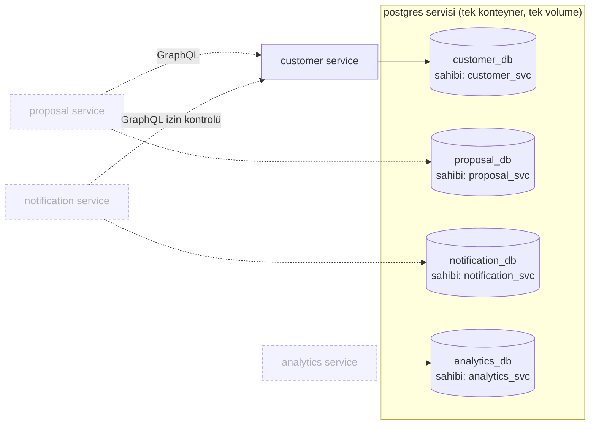
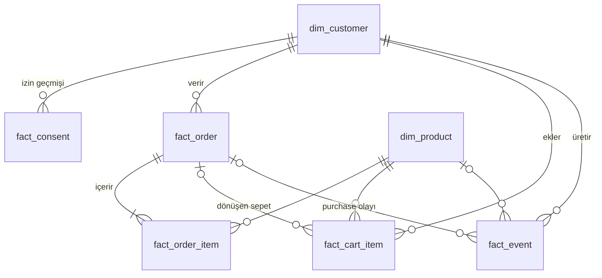

# Veritabanı mimarisi

Smart Campaign Composer için veri katmanının tasarımı. Kararların gerekçeleri ve bedelleri [DECISIONS.md](../DECISIONS.md) içindedir (D-003 … D-005, D-017, D-019, D-020); bu belge yapının kendisini anlatır.

## 1. Amaç ve kapsam

Mikroservis mimarisini göstermek için her servis kendi veritabanına sahip olur. Demo maliyetini düşük tutmak için bu veritabanları **tek bir Postgres servisinde**, ayrı `DATABASE`'ler olarak yaşar.

Bu aşamada teslim edilenler:

- Docker üzerinde tek Postgres servisi (`postgres:18-alpine`, 18.6).
- Kök dizinde başlangıç `docker-compose.yml`.
- `customer_db` veritabanının oluşturulması ve `stub/` altındaki müşteri verisiyle doldurulması.
- `proposal_db`, `notification_db` ve `analytics_db`'nin sahip rolleri ve servis adlı boş şemalarıyla açılması (T-008, D-019, D-048).

Bu aşamada **yapılmayanlar**: servis veritabanlarının tabloları (goose migration'larıyla gelecek, D-020), servisler arası erişim (API/olay). Kampanya stub'ları (`acw_campaigns.csv`, `acw_campaign_messages.csv`) yüklenmez.

## 2. Hedef yerleşim



| Veritabanı | Sahip rol | Servis | Durum |
|---|---|---|---|
| `customer_db` | `customer_svc` | customer service | **Bu aşamada kuruldu** |
| `proposal_db` | `proposal_svc` | proposal service (kampanya, teklif adımları ve varyantları, LLM çağrıları, outbox; D-022) | Kuruldu, boş `proposal` şeması |
| `notification_db` | `notification_svc` | notification service (teslimatlar, idempotency, outbox; D-023) | Kuruldu, boş `notification` şeması |
| `analytics_db` | `analytics_svc` | analytics service (olay tüketicisi; D-018) | Kuruldu, boş `analytics` şeması |

Bu veritabanlarının tabloları, durum makineleri ve olay sözleşmeleri [domain-model.md](domain-model.md) belgesinde. Servis veritabanları initdb'de `customer_db` ile aynı desenle açılır: sahip rol, `REVOKE ALL … FROM PUBLIC`, `CONNECT` ve `TEMPORARY`. Her birinde rolün sahibi olduğu, servis adlı bir şema vardır ve rolün `search_path`'i `<şema>, public`'tir (D-019, D-048). Tabloları her servisin goose migration'ları kurar (D-020).

## 3. İzolasyon modeli

Tek Postgres kümesi içinde servis sınırı veritabanı ve rol düzeyinde zorlanır:

- Her veritabanının sahibi yalnızca o servisin rolüdür (`CREATE DATABASE customer_db OWNER customer_svc`).
- `REVOKE ALL ON DATABASE customer_db FROM PUBLIC` ile başka roller bağlanamaz bile.
- Rol, `search_path`'i `dwh, public` olarak ayarlanmış şekilde gelir (`ALTER ROLE … IN DATABASE`).
- Postgres veritabanları arası `JOIN` desteklemez. Bu demoda bir kısıt değil, istenen özelliktir: başka bir servis müşteri verisine **customer service üzerinden** ulaşır, doğrudan bağlanmaz. Bu etkileşim senkron GraphQL çağrılarıyla olur (D-007, D-011); asenkron olaylar NATS üzerinden gider (D-006).
- `postgres` süper kullanıcısı yalnızca kurulum (init) için kullanılır; uygulamalar ona bağlanmaz.

Bedel: tüm servisler aynı süreç, bellek ve diski paylaşır; bir servisin ağır sorgusu diğerlerini etkiler. Gerçek ortamda her DB ayrı kümeye taşınabilir, bağlantı dizesi dışında kod değişmez.

## 4. `customer_db`: filtrelenmiş DWH

`customer_db`, müşteri verisinin segmentasyon için hazırlanmış, **filtrelenmiş bir veri ambarı kopyası** gibi kullanılır. Kaynak `stub/*.csv` setidir (bkz. [stub/README.md](../stub/README.md)); veri seed ile gelir. Tek yazma yolu izin güncellemesidir (D-011: `updateConsent` yeni `fact_consent` satırı yazar ve `dim_customer` bayrağını aynı transaction'da günceller). Bu yol yalnız admin token'ıyla çağrılır (D-063): `make consent CUSTOMER=<id> CHANNEL=<email|sms> OPTED_IN=<true|false>`. Yeni kayıt kimlikleri `CNS-` sırasını sürdürür (advisory lock altında en büyük numara + 1, D-064).

Yerleşim yıldız şemadır, hepsi `dwh` şemasında:



| Tablo | Kaynak CSV | Birincil anahtar | Satır | Rol |
|---|---|---|---|---|
| `dim_customer` | `acw_user_data.csv` | `customer_id` | 3000 | Müşteri başına tek geniş satır; özet ve davranış kolonları dahil |
| `dim_product` | `acw_products.csv` | `product_id` | 159 | Ürün kataloğu |
| `fact_order` | `acw_orders.csv` | `order_id` | 11.9k | Sipariş başlığı |
| `fact_order_item` | `acw_order_items.csv` | (`order_id`, `line_no`) | 27.9k | Sipariş satırı; aynı ürün bir siparişte iki kez geçebildiği için `line_no` anahtarda |
| `fact_cart_item` | `acw_cart_items.csv` | `cart_item_id` | 11.9k | Sepet kalemi ve sonucu |
| `fact_event` | `acw_events.csv` | `event_id` | 138k | Son 90 günün davranış olayları |
| `fact_consent` | `acw_consents.csv` | `consent_id` | 6.7k | Kanal izni olay günlüğü |

### Segmentasyon için iki yol

1. **Özet kolonlar** (`dim_customer`): `city`, `has_open_cart`, `last_cart_add_date`, `last_order_date`, `email_opt_in`, `sms_opt_in`, `loyalty_tier` … Tek tablo, hızlı, LLM'in kullanacağı alan beyaz listesi dar tutulabilir.
2. **Fact pencereleri**: "son 7 günde Electronics ürünü görüntüledi" gibi özet kolonda olmayan kurallar `fact_event` / `fact_cart_item` / `fact_order` üzerinden `EXISTS` alt sorgusuyla yazılır.

Örnek brief (son 30 günde sepete ekleyip almayan İstanbul'daki, SMS izni olan kullanıcılar) fact yolu ile:

```sql
SELECT c.customer_id, c.first_name, c.phone_e164
FROM dwh.dim_customer c
WHERE c.city = 'İstanbul'
  AND c.account_status = 'active'
  AND c.sms_opt_in AND c.phone_e164 IS NOT NULL
  AND EXISTS (SELECT 1 FROM dwh.fact_cart_item ci
              WHERE ci.customer_id = c.customer_id
                AND ci.added_at >= now() - INTERVAL '30 days')
  AND NOT EXISTS (SELECT 1 FROM dwh.fact_order o
                  WHERE o.customer_id = c.customer_id
                    AND o.order_date >= now() - INTERVAL '30 days');
-- beklenen: 33 satır (üreticinin bastığı huniyle aynı)
```

Üretici veriyi `AS_OF = 2026-10-26 12:00 UTC` anına göre üretir. Seed yüklenirken tüm zaman kolonları yükleme anına kaydırılır (D-017), bu yüzden örnek sorgu `now()` kullanır. Volume eskidikçe veri yine kayar; `docker compose down -v && docker compose up -d` veriyi tazeler.

### `dim_customer` kolonları

Ham satırdaki 55 kolondan **5'i alınmaz**: `Credit Card Start Date`, `Credit Card Expiry Date`, `Credit Card Number`, `Credit Card CVV`, `Bank IBAN`. Geriye kalan 50 kolon `snake_case` adlarla alınır.

| Grup | Kolonlar |
|---|---|
| Kimlik | `customer_id`, `first_name`, `last_name`, `sex`, `date_of_birth`, `age_years`, `marital_status`, `dependants` |
| İletişim | `email`, `email_bounced`, `phone_e164` |
| Konum ve dil | `country_code`, `city`, `language`, `timezone`, `address_street`, `address_city`, `address_postcode` |
| Yaşam döngüsü | `signup_date`, `account_status`, `deleted_at`, `last_active_date`, `preferred_platform` |
| İzin | `email_opt_in`, `sms_opt_in`, `consent_updated_at` |
| Alışveriş özeti | `total_orders`, `total_spend_gbp`, `avg_order_value_gbp`, `first_order_date`, `last_order_date`, `favourite_category`, `last_cart_add_date`, `has_open_cart`, `open_cart_value_gbp`, `sessions_90d`, `loyalty_tier`, `loyalty_points` |
| Kampanya özeti | `campaigns_received_90d`, `emails_opened_90d`, `last_campaign_sent_at` |
| Ham demografi | `employer_company`, `yearly_salary_gbp`, `yearly_pension_gbp`, `retired`, `commute_distance_km`, `vehicle_make`, `vehicle_model`, `vehicle_year`, `vehicle_type` |

Notlar:

- `city` segmentasyon şehridir. `address_*` kolonları ham UK adresidir ve şehir filtresi için kullanılmamalıdır.
- Boş string'ler `NULL` olur; `employer_company = 'N/A'` (emekliler) `NULL` olur.
- Kampanya özeti kolonları stub üretimindeki geçmiş kampanyalardan türemiş bir anlık görüntüdür. Kampanya tabloları yüklenmediği için bunlar şimdilik yalnızca okunur bilgi taşır.
- Kategorik kolonlarda `CHECK` kısıtları vardır (`account_status`, `loyalty_tier`, `preferred_platform`, `country_code`, `language`, `sex`). Bunlar ileride LLM'in ürettiği segment kuralındaki değerleri doğrulamak için de kaynak olur.

### İndeksler

Segment sorgularının sık filtrelediği yerler: `dim_customer (city)`, `(country_code)`, `(last_cart_add_date)`, `(last_order_date)`; `fact_order (customer_id, order_date)`; `fact_cart_item (customer_id, added_at)`; `fact_event (customer_id, event_time)` ve `(event_type, event_time)`; `fact_consent (customer_id, channel, changed_at)`; FK tarafındaki `product_id` / `order_id` kolonları.

## 5. Kurulum ve seed hattı

```
docker-compose.yml
infra/postgres/initdb/
├── 00-init.sh                  # entrypoint'in çalıştırdığı tek dosya; sırayla aşağıdakileri koşar
└── sql/
    ├── 01_customer_db.sql      # rol + veritabanı + yetkiler (süper kullanıcı, postgres DB'sinde)
    ├── 02_customer_schema.sql  # dwh şeması ve tablolar (customer_svc sahipliğinde)
    ├── 03_customer_seed.sql    # CSV → TEMP staging → dwh, doğrulama, ANALYZE (tek transaction)
    └── 04_service_db.sql       # servis başına rol + DB + şema; -v svc=<ad> ile üç kez çalışır
```

Akış:

1. `docker compose up` ilk kez, **boş volume** ile çalışınca Postgres imajı `/docker-entrypoint-initdb.d/00-init.sh`'i çalıştırır. Alt dizindeki `.sql` dosyaları imaj tarafından otomatik çalıştırılmaz; sırayı `00-init.sh` belirler.
2. `stub/` dizini konteynere `/seed/stub` olarak **salt-okunur** bağlanır.
3. Seed her CSV'yi, kolon adları CSV başlıklarıyla birebir aynı olan bir `TEMP` tabloya `COPY … (FORMAT csv, HEADER MATCH)` ile alır. `HEADER MATCH`, CSV kolon sırası değişirse yüklemeyi hatayla durdurur.
4. Tiplere dönüştürülmüş veri `dwh` tablolarına yazılır. Bu sırada `timestamptz` kolonları `now() - AS_OF` aralığı, `date` kolonları aynı farkın tam gün sayısı kadar ileri kaydırılır (D-017); fark psql `\gset` ile bir kez hesaplanır. Kart, CVV ve IBAN yalnızca oturuma özel, WAL'a yazılmayan `TEMP` tabloda bulunur ve oturum bitince silinir; kalıcı hiçbir tabloya girmez.
5. Seed sonunda doğrulama yapılır; biri tutmazsa transaction geri alınır ve konteyner kurulumu hata verir:
   - her tablo boş değil,
   - `dim_customer.email_opt_in` / `sms_opt_in`, `fact_consent`'teki son kayıtla aynı,
   - her siparişin `subtotal_gbp` değeri satırlarının toplamına eşit,
   - olay, sipariş, sepet ve izin zaman damgalarının hiçbiri `now()`'dan sonra değil.
6. `00-init.sh`, seed'den sonra `04_service_db.sql`'i `proposal`, `notification` ve `analytics` için çalıştırır.
7. Healthcheck, `customer_svc` ile TCP üzerinden `dwh.dim_customer`'dan satır okuyabildiğinde ve her servis rolü kendi DB'sine bağlanıp `current_schema()` olarak kendi şemasını gördüğünde servisi `healthy` sayar (D-048). Init sırasında geçici sunucu TCP dinlemediği için init bitmeden `healthy` görünmez.

Init yalnızca boş volume'da çalışır. Şema veya stub değişince sıfırdan kurmak gerekir:

```bash
docker compose down -v && docker compose up -d
```

## 6. Bağlantı

| Değer | Varsayılan | Değişken |
|---|---|---|
| Host portu | `5433` (makinedeki 5432 başka projede) | `POSTGRES_HOST_PORT` |
| Veritabanları | `customer_db`, `proposal_db`, `notification_db`, `analytics_db` | — |
| Uygulama rolleri | `customer_svc`, `proposal_svc`, `notification_svc`, `analytics_svc` | parola: `CUSTOMER_DB_PASSWORD`, `PROPOSAL_DB_PASSWORD`, `NOTIFICATION_DB_PASSWORD`, `ANALYTICS_DB_PASSWORD` |
| Süper kullanıcı | `postgres` | `POSTGRES_USER`, `POSTGRES_PASSWORD` |

Varsayılan parolalar yalnızca yerel geliştirme içindir; `.env.example` kopyalanıp `.env` ile değiştirilebilir. `.env` git'e girmez.

```bash
docker compose exec postgres psql -U customer_svc -d customer_db
```

## 7. Açık konular

- Diğer servis veritabanları, servisler arası erişim ve migration aracı karara bağlandı (D-011, D-019, D-020); kalan ayrıntılar DECISIONS.md'nin açık konularında.
- ~~1000 kullanıcının "birkaç bin"e çıkarılması.~~ 3000 kullanıcıya çıkarıldı (D-113).
- Türkçe büyük/küçük harf duyarsız şehir eşleşmesi (`İstanbul` / `istanbul`): veritabanı varsayılan `en_US.utf8` collation'ı ile oluşturulur, segment doğrulaması şimdilik tam eşleşme varsayar.
  - 2026-10-27 araştırması: Alpine/musl imajında `ILIKE` İ için eşleşiyor, noktasız ı için eşleşmiyor ve bu imaja bağlı. Öneri collation'a dayanmamak; ayrıntı [research/04-data-platform.md](research/04-data-platform.md#4-türkçe-büyükküçük-harf-duyarsız-şehir-eşleşmesi).
