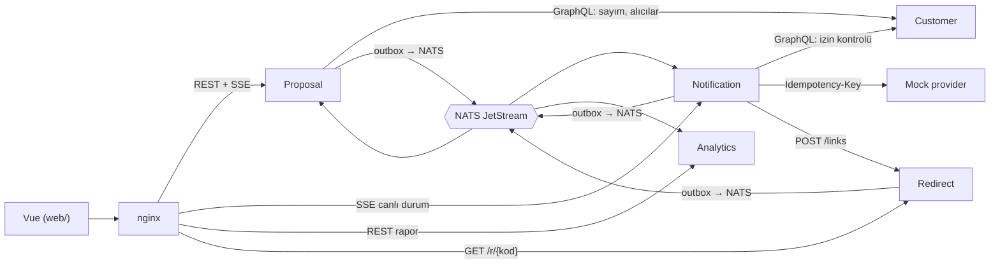
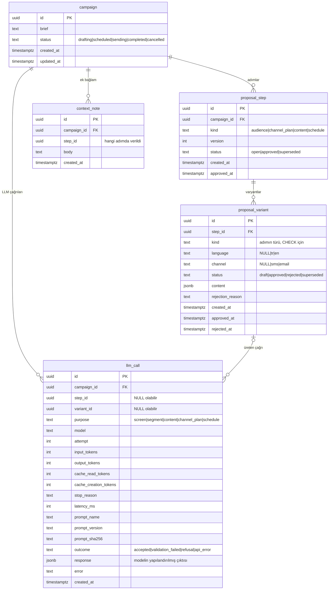
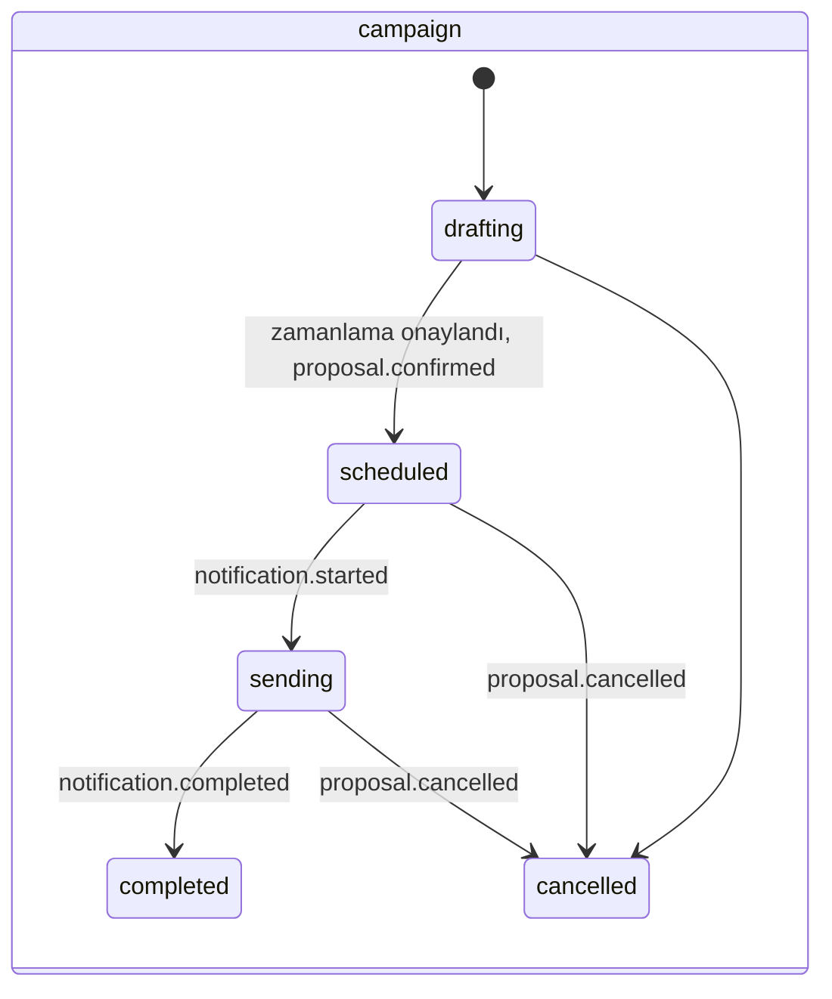
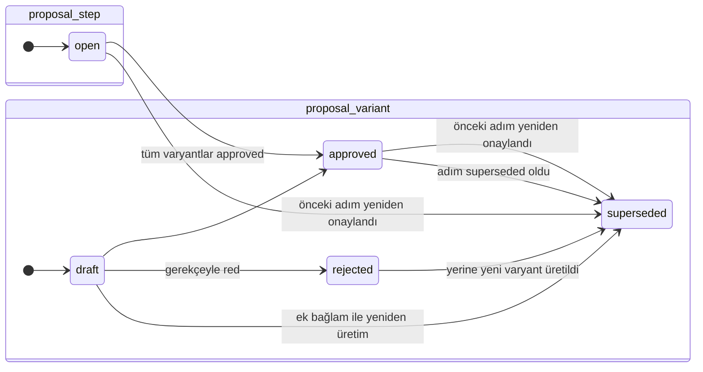
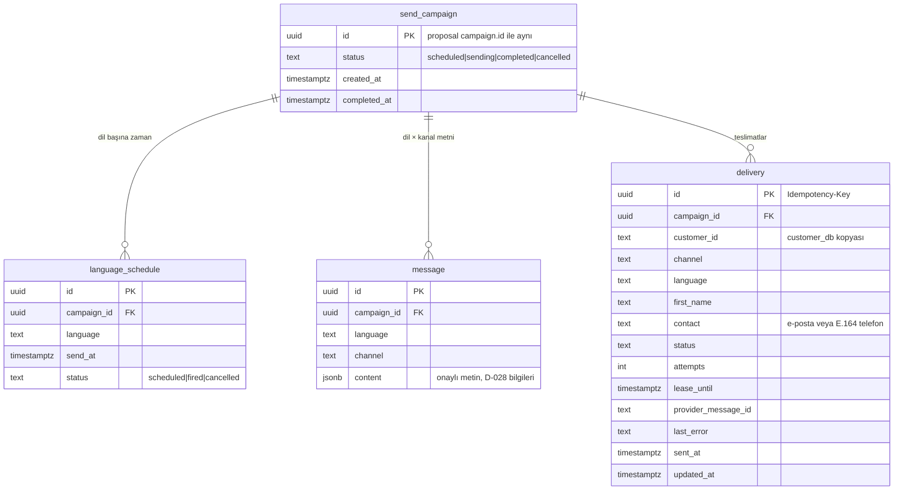
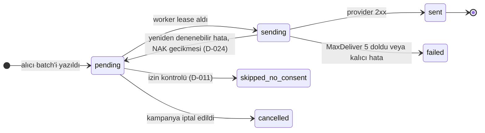
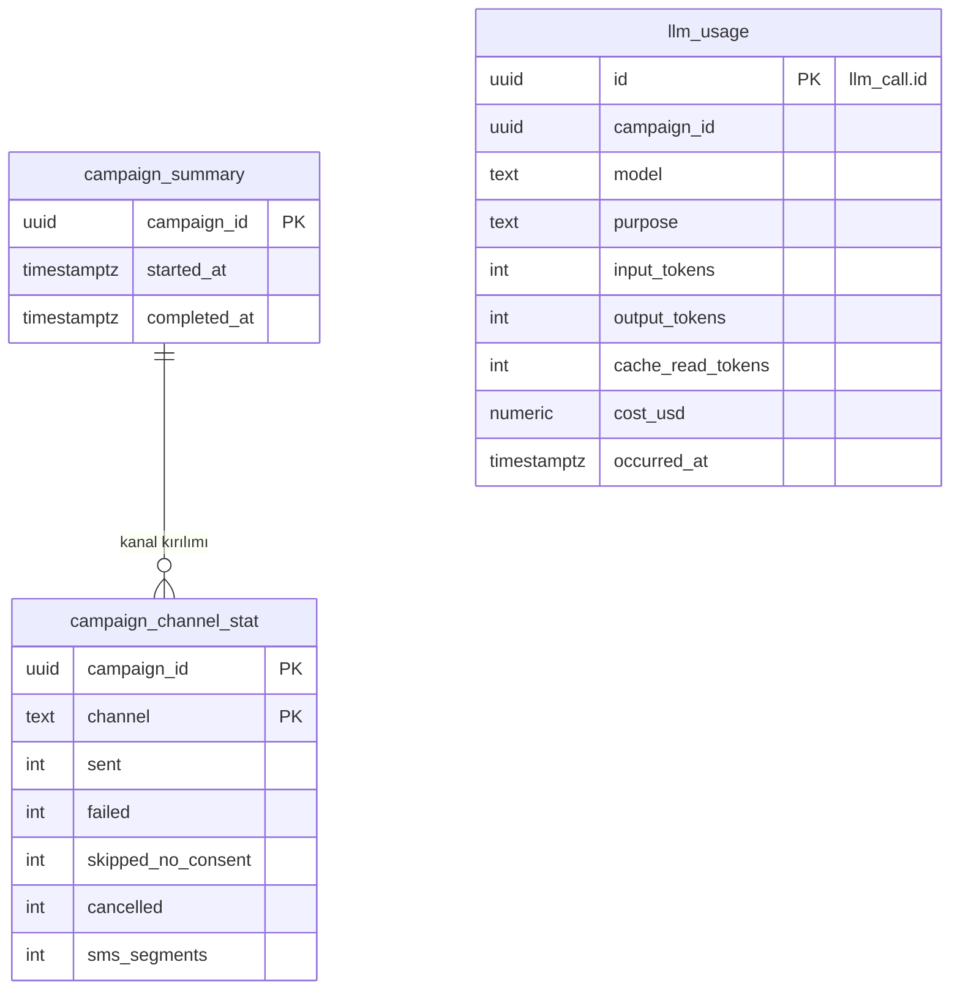
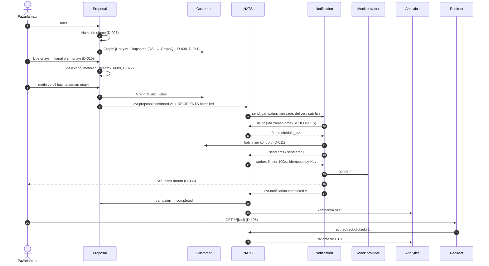

# Domain modeli

Smart Campaign Composer'ın servisleri, veri modelleri, durum makineleri ve olay sözleşmeleri. Gerekçeler [DECISIONS.md](../DECISIONS.md) içindedir; bu belge yapının kendisini anlatır. `customer_db` için ayrıntı [database-architecture.md](database-architecture.md).

> **Durum (2026-10-27):** Tasarım belgesi, henüz kod veya migration yok (D-029).
> - **Kesin:** karar numarası verilen her şey. Örnekler: tablo sınırları, durum değerleri, unique kısıt, stream'ler, zarf.
> - **Taslak:** "taslak" işaretli kolon listeleri, `content` şemaları ve kısıt önerileri. Bunlar migration yazılırken kullanıcıyla kesinleşir (CLAUDE.md, Kodlama kuralları §7). Olay kataloğu (§6) koddan alınmıştır ve taslak değildir.

## 1. Servisler ve sahiplik

| Servis | Veritabanı / rol | Sahip olduğu kavramlar | Yayınlar | Tüketir |
|---|---|---|---|---|
| Customer | `customer_db` / `customer_svc` | Müşteri, ürün, sipariş, sepet, olay, izin (D-004) | — | — |
| Proposal | `proposal_db` / `proposal_svc` | Kampanya, teklif adımı, varyant, ek bağlam, LLM çağrısı (D-022) | `proposal.confirmed`, `proposal.cancelled`, `proposal.token_completed`; alıcı batch'leri | `notification.started`, `notification.completed` (kampanya durumu, D-033, D-080) |
| Notification | `notification_db` / `notification_svc` | Gönderim kampanyası, (dil, saat dilimi) zamanlaması, mesaj, teslimat (D-023, D-077) | `notification.started`, `notification.completed` | `proposal.confirmed`, `proposal.cancelled`, alıcı batch'leri, zamanlama tetikleri, `send.*` |
| Analytics | `analytics_db` / `analytics_svc` | Kampanya özeti, LLM kullanımı ve maliyeti, tıklama (D-036, D-108) | — | `notification.completed`, `proposal.token_completed`, `redirect.clicked` |
| Redirect | `redirect_db` / `redirect_svc` | İmzalı kısa link, tıklama (D-106, D-107) | `redirect.clicked` | — (`POST /links` Notification'dan, `GET /r/{kod}` nginx'ten) |
| Mock provider | DB yok | Idempotency yanıt önbelleği (bellekte, taslak) | — | — |

Customer'ın GraphQL sözleşmesi `internal/customer/graph/schema.graphqls`'tedir (D-058): `audiencePreview`, `audienceRecipients` (keyset sayfalama, `first` ≤ 1000), `consentStatus` ve `updateConsent`; `POST /graphql`, introspection kapalı. `audiencePreview` ve `audienceRecipients` çalışır (T-015): filtre beyaz listeli bir derleyiciyle parametreli SQL'e çevrilir, her sorguya ulaşılabilirlik koşulu eklenir, şehir kanonik sözlükle eşlenir (D-062). `consentStatus` (en fazla 1000 id; bilinmeyen id uygun değil) ve `updateConsent` (yalnız değişiklikte `fact_consent` + `dim_customer` aynı transaction'da, kapalı `source` listesi) çalışır (T-017, D-064). Her istek `Authorization: Bearer <token>` taşır; token yoksa 401, kapsam yoksa `FORBIDDEN` (D-063). Kapsamlar: Proposal `audience:read`, Notification `consent:read`, admin token `consent:write` + `consent:read`; izin geri çekme bir geliştirici komutuyla yapılır, arayüzden değil.

Senkron çağrılar Customer'ın GraphQL'ine gider: Proposal kitle sayımı ve alıcı listesi için (D-007), Notification gönderim öncesi izin kontrolü için (D-011). Bir de Notification intake'i teslimat satırlarını yazarken batch başına Redirect'in `POST /links` ucunu çağırır (D-106); gönderim anında Redirect'e ağ çağrısı yoktur. Erişim her durumda bu uç noktada zorlanır: her servis kendi token'ı ve kapsamıyla çağırır, alan beyaz listesi sunucudadır ve nginx Customer'ı dışarı açmaz (D-042, D-043). Canlı durum, Notification'dan SSE ile gelir (D-036). Diğer her şey NATS'tir (D-006).



### Konteynerler (D-021, D-056)

Her servis `Dockerfile`'dan `SERVICE` build arg'ıyla derlenen distroless (nonroot) bir imajdır; `main`'i `internal/platform/app` üzerinden çalışır.

| Servis | Bağımlılıklar | Host portu | Readiness kontrolleri |
|---|---|---|---|
| customer | `customer_db` | yok (yalnız compose ağı, D-043) | postgres |
| proposal | `proposal_db` + platform migration'ları, NATS | 8081 | postgres, nats |
| notification | `notification_db` + platform migration'ları, NATS | 8082 | postgres, nats |
| analytics | `analytics_db` + platform migration'ları, NATS | 8083 | postgres, nats |
| redirect | `redirect_db` + platform migration'ları, NATS | 8085 | postgres, nats |
| mockprovider | yok | 8084 | — |

`API_DOCS_ENABLED` açıkken (compose'da varsayılan) proposal, notification, analytics, redirect ve mockprovider `GET /docs` (Scalar) ve `GET /openapi.json` (swag v2 ile üretilip binary'ye gömülen OpenAPI 3.1 spec'i) sunar; kapalıyken bu yollar yoktur. Spec'ler `make generate` ile `cmd/<servis>/apidocs/swagger.json` olarak üretilir ve commit edilir; şimdilik yalnız `/healthz` ve `/readyz`'i belgeler (D-057).

Konteyner içinde hepsi `:8080` dinler; compose healthcheck'i `/app -healthcheck` ile `/readyz`'i yoklar. Servisler `postgres` sağlıklı olana ve `nats-init` bitene kadar bekler. İş mantığı, route'lar ve worker'lar servis görevlerinde `app.Options.Setup` kancasıyla eklenir.

## 2. Ortak kurallar

- **Kimlik:** yeni tablolarda `id uuid DEFAULT uuidv7()` (D-030). Olay id'si ve `Idempotency-Key` de UUIDv7.
- **Servisler arası referans:** başka servisin kimliği yabancı anahtar değil, düz kolondur. Örnek: `delivery.customer_id`, `customer_db`'deki `customer_id`'nin kopyasıdır. Veritabanları arası `JOIN` yok (D-003).
- **Zaman:** tüm zaman damgaları `timestamptz`, UTC.
- **Outbox:** olay yayınlayan her servisin DB'sinde `outbox` tablosu. Olay, iş satırıyla aynı transaction'da yazılır ve relay NATS'e taşır (D-006).
- **Tüketici dedup'u:** olay tüketen her serviste `processed_event(event_id PRIMARY KEY, processed_at)`. Olayı işleyen transaction'da önce buraya yazılır; çakışma olursa olay atlanır (D-023).
- **Sabit değerler:** dil `tr | en` ve kanal `sms | email`, `customer_db` ile aynıdır.

`outbox`: `id uuid DEFAULT uuidv7()` (olay id'si), `subject`, `payload jsonb` (id'siz zarf; relay yayınlarken id'yi ekler), `created_at`, `published_at NULL`; yayınlanmamışlar için kısmi indeks ve `pg_notify('outbox', '')` çağıran statement trigger'ı. `processed_event`: `event_id uuid PRIMARY KEY`, `processed_at`. İkisini de platform migration seti (`goose_platform_version`) servis migration'larından önce açar; satırlar silinmez (D-054).

### Servis platformu (D-031, D-050)

Her Go servisi `internal/platform/` paketlerini kullanır:

| Paket | Sağladığı |
|---|---|
| `config` | Viper: koddaki varsayılanlar, çalışma dizinindeki isteğe bağlı `.env`, sonra öneksiz ortam değişkenleri (ortam önceliklidir); `Require` eksik anahtarları tek hatada toplar |
| `logging` | `log/slog` JSON logger, seviye `LOG_LEVEL` |
| `health` | `/healthz` (yalnız süreç) ve `/readyz` (kayıtlı kontroller eşzamanlı, kontrol başına 2 sn; JSON `{status, checks}`, başarısızlıkta 503) |
| `metrics` | Servise özel Prometheus registry, Go ve process collector'ları, `http_requests_total{method,route,status}`, `http_request_duration_seconds{method,route}` |
| `db` | pgx/v5 havuzu (`DATABASE_URL`; havuz ayarları URL'den) ve `/readyz` için ping kontrolü (D-020) |
| `migrate` | Gömülü goose migration'ları açılışta Postgres advisory lock altında uygular; sürüm tablosu rolün `search_path`'indeki ilk şemaya düşer (D-020, D-048, D-051) |
| `events` | D-035 zarfı (`Envelope`), `Subject` (`evt.<servis>.<olay>.v<n>`) ve ad doğrulaması |
| `outbox` | `Write` (iş transaction'ı içinde), `Relay` (ayrı bağlantıda `LISTEN outbox`, 1 sn poll yedeği, `SKIP LOCKED`, `Nats-Msg-Id` = olay id'si, PubAck sonrası `published_at`) (D-054) |
| `consumer` | `Processor.Process`: `processed_event` ile dedup ve handler aynı transaction'da, ack commit'ten sonra; hatada `NakWithDelay` (1 sn ×2, %20 jitter, 15 dk tavan), `MaxDeliver` 20 sonunda `Term`; bozuk ileti hemen `Term` (D-054, D-055) |
| `httpserver` | chi router (RequestID → istek logu → metrik → Recoverer), `/healthz`, `/readyz`, `/metrics`; `WriteTimeout`'suz sunucu (SSE) ve bağlam iptalinde zarif kapanış |

Ortak anahtarlar: `HTTP_ADDR` (`:8080`), `LOG_LEVEL` (`info`), `SHUTDOWN_TIMEOUT` (`10s`), `DATABASE_URL`. Servise özel anahtarlar (`NATS_URL` …) servis görevlerinde eklenir.

Migration dosyaları servis klasöründe sıralı numaralıdır (`00001_<ad>.sql`), sqlc `go tool sqlc` ile çalışır ve üretilen kod commit edilir (D-051). Make hedefleri: `test` (birim + entegrasyon, Docker gerekir), `test-unit`, `coverage` (rapor `coverage/` altında, eşik yok, D-052), `generate`.

## 3. proposal_db



Kolon listeleri kesindir (D-068); migration'lar `internal/proposal/store/migrations` altındadır, sqlc kodu aynı pakette üretilir. Kısıtlar:

- Durum ve tür sütunları `text` + `CHECK`. `approved` satırda `approved_at` dolu, `open` adımda ve `draft` varyantta boş; `rejected` varyantta `rejected_at` ve `rejection_reason` dolu; `superseded` satır eski damgalarını korur.
- `proposal_step_live_kind_key`: kampanyada tür başına en fazla bir `superseded` olmayan adım. `proposal_step_campaign_kind_version_key`: `(campaign_id, kind, version)` tekildir.
- `proposal_variant_live_slot_key`: adımda (`language`, `channel`) başına en fazla bir `draft` veya `approved` varyant (`NULLS NOT DISTINCT`). `proposal_variant_step_kind_fkey`: varyantın `kind`'ı adımınkiyle aynıdır.
- `context_note` ve `llm_call` ekleme-yalnızdır: `reject_row_change()` trigger'ı `UPDATE` ve `DELETE`'i reddeder.
- Tüm yabancı anahtarlarda indeks vardır.

### Varyant biçimi (D-034)

| Adım türü | Varyant sayısı | `language` | `channel` |
|---|---|---|---|
| `audience` | 1 | NULL | NULL |
| `channel_plan` | 1 | NULL | NULL |
| `content` | kitledeki her dil × plandaki her kanal (yalnız alıcısı olan çiftler, D-010) | dolu | dolu |
| `schedule` | kitledeki her (dil, saat dilimi) çifti (D-076) | dolu | NULL; `timezone` dolu |

`proposal_variant_shape_check`:

```sql
CHECK (
  (kind IN ('audience', 'channel_plan') AND language IS NULL AND channel IS NULL)
  OR (kind = 'content'  AND language IS NOT NULL AND channel IS NOT NULL)
  OR (kind = 'schedule' AND language IS NOT NULL AND channel IS NULL)
)
```

`content` alanının şeması adım türüne göre değişir:

| Tür | `content` (taslak) |
|---|---|
| `audience` | `{dsl, filter, count, coverage: {both, email_only, sms_only, unreachable}, by_language: [{language, count, coverage, max_first_name_length}], max_first_name_length}` (D-007, D-010, D-070, D-071) |
| `channel_plan` | `{mode: single \| primary_fallback \| both, primary: sms \| email, rationale, recipients: {email, sms, total}, by_language}` (D-010, D-070) |
| `content` / sms | `{text, encoding: gsm7 \| ucs2, segments, rendered_length, estimated_cost_gbp}` (D-028, D-071) |
| `content` / email | `{subject, preheader, headline, paragraphs[], cta_label, max_rendered_lengths, estimated_cost_gbp}`; HTML saklanmaz, `internal/content` yuvalı şablonla çizer (D-071) |
| `schedule` | `{send_at, rationale}`; yuvanın saat dilimi `timezone` sütunundadır; `send_at` `null` hemen gönderim demek (D-070, D-076) |

### Durum makineleri (D-033, D-022)





Kurallar:

- Adım sırası `audience → channel_plan → content → schedule`. Bir adım, öncekinin `approved` sürümü olmadan açılmaz.
- Kitle yeniden onaylanırsa `channel_plan`, `content` ve `schedule` superseded olur. Kanal planı değişirse yalnız `content` ve `schedule` superseded olur (D-010).
- Ek bağlam (D-009) bir `context_note` yazar. Açık adımın onaylanmamış varyantları superseded olur ve yeniden üretilir; onaylı varyantlar korunur.
- Red yalnız o varyantı yeniden üretir (D-009). Yeni varyant aynı adımda açılır, `version` artmaz.
- Güncel adım: `status = 'open'` olan, yoksa son `approved` adım. Kampanyada saklanmaz (D-033).
- Satırlar silinmez. Bir kampanyada her tür için en fazla bir adım `superseded` dışında olabilir (`proposal_step_live_kind_key`).
- Akış `internal/proposal/flow`'dadır (D-070). Kanal planını ve dil başına zamanı Haiku 5.5 önerir, kod doğrular. Elle düzenleme aynı doğrulayıcılardan geçen yeni bir `draft` varyanttır. `Reopen` onaylı bir adımı ve sonraki tüm adımları `superseded` yapıp yeni sürüm açar. Başarısız üretim adımın son `llm_call` satırlarından okunur ve `Regenerate` ile, ön elemede yarım kalan kampanya `RegenerateCampaign` ile sürdürülür. Ön eleme brief'i engellerse kampanya `cancelled` olur.
- Üretim kampanya başına Postgres advisory lock altında arka planda çalışır; ilerleme süreç içi olay dağıtıcısına yazılır (T-025 SSE).

## 4. notification_db



Diyagram ilk taslaktır; kesin şema D-077'dir: `language_schedule` yerine (dil, saat dilimi) başına `locale_schedule` (D-076), `delivery`'de `schedule_id` ve `message_id` FK'leri, batch takibi için `recipient_batch` ve `send_campaign.batch_count`, durum CHECK'leri, `delivery (campaign_id, channel, status)` ve kısmi `delivery (schedule_id) WHERE status = 'pending'` indeksleri, kampanya bitince `first_name` ve `contact` alanlarının `NULL` yapılması. `send_campaign` adı, Proposal'daki `campaign`'den ayırmak için seçildi. `customer_id`, `customer_db`'deki gibi `text`'tir.

Kesin olanlar (D-023):

- `UNIQUE (campaign_id, customer_id, channel)`; alıcı batch'leri `ON CONFLICT DO NOTHING` ile yazılır.
- `Idempotency-Key` = `delivery.id`.
- Notification kanal seçmez. Her alıcı Proposal'ın atadığı kanalla gelir (D-010).



`skipped_no_consent` kişi diğer kanala düşürülmez (D-011). Customer'a ulaşılamazsa satır `pending` kalır ve ertelenir; izni doğrulanmamış kimseye gönderim yapılmaz (fail-closed).

Canlı dashboard bu tablonun `campaign_id, channel, status` kırılımındaki anlık sayımlarını yayar (D-036): `GET /campaigns/{id}/deliveries` ve SSE `GET /campaigns/{id}/deliveries/events` (bağlanınca snapshot, sayılar değişince yeni snapshot, bitince `done`; 1 sn DB yoklaması, D-080). Kampanya, tüm zamanlamaları tetiklenip bekleyen veya gönderimdeki teslimatı kalmayınca 2 sn'lik denetleyiciyle `completed` olur ve kişisel veri temizlenir (D-077, D-080).

## 5. analytics_db

Diyagram ilk taslaktır; kesin şema D-083'tür: `campaign_summary(campaign_id, completed_at, sms_segments, delivery_cost_usd)`, `campaign_delivery_count(campaign_id, channel, status, count)` ve `llm_usage(llm_call_id, campaign_id, purpose, model, prompt_name, prompt_version, token sayıları, outcome, latency_ms, cost_usd)`; tablolar arasında FK yoktur, kampanyanın LLM maliyeti raporda `SUM(llm_usage.cost_usd)` ile hesaplanır. Tüm maliyetler USD'dir. Rapor uçları: `GET /campaigns`, `GET /campaigns/{id}/summary`, `GET /llm-usage?group=prompt_version`. Tıklama takibi (CTR) `evt.redirect.clicked.v1` ve `sent_by_locale` üzerinden Analytics'tedir (D-106–D-108; D-082'nin yerini aldı).



Analytics bir olayı birden çok kez alabilir. Bu yüzden `processed_event` dedup'u ve `llm_usage.id = llm_call.id` birincil anahtarı birlikte tekrarı engeller.

## 6. NATS sözleşmeleri

### Stream'ler (D-024, D-049)

| Stream | Saklama | Konular | İçerik |
|---|---|---|---|
| `EVENTS` | limits, 7 gün | `evt.>` | Servisler arası olaylar; servis başına durable tüketici |
| `RECIPIENTS` | work-queue | `recipients.>`; kampanya başına alt konu `recipients.<campaign_id>` (D-074) | Alıcı batch'leri; Notification DB'ye yazıp ack verince silinir |
| `SCHEDULES` | limits, süresiz, `AllowMsgSchedules` | `sched.<schedule_id>` ve `fire.<schedule_id>`; (dil, saat dilimi) başına bir zamanlama (D-076) | (Dil, saat dilimi) başına tek zamanlama (D-076); `sched.*` iletisi `Nats-Schedule` header'larıyla yayınlanır ve vadesi gelince sunucu onu `fire.<schedule_id>`'ye düşürür; gönderim zamanı olmayan zamanlama doğrudan `fire.*`'a yazılır. Yük `{schedule_id, campaign_id}` |
| `SEND` | work-queue | `send.sms`, `send.email` | Teslimat başına ileti, `{delivery_id}` |

Stream'lerin hepsi dosya depolamalı, tek replikalı; dedup penceresi 2 dakika, ileti sınırı 1 MB. Tanımlar `infra/nats/streams/*.json` dosyalarındadır; compose'daki tek seferlik `nats-init` konteyneri her `up`'ta bunları oluşturur veya günceller. Servisler stream oluşturmaz (D-049).

İptal API'si olmadığı için tetiklenen `fire.*` iletisini işleyen worker, `send_campaign` ve `language_schedule` durumunu kontrol eder. İptal edilmişse iletiyi düşürür (D-006).

### Zarf (D-035)

```json
{
  "id": "0199f3a2-7c4e-7b1a-9d2e-5f6a7b8c9d0e",
  "type": "proposal.confirmed",
  "version": 1,
  "occurred_at": "2026-10-27T09:00:00Z",
  "producer": "proposal",
  "correlation_id": "0199f3a1-0000-7000-8000-000000000001",
  "data": {}
}
```

- Konu `evt.<servis>.<olay>.v1`; `id`, `Nats-Msg-Id` header'ı olarak da gönderilir.
- `correlation_id` kampanya id'sidir.
- Sürüm içinde yalnız alan eklenir; kırıcı değişiklik `.v2` konusuna gider.

### Olay kataloğu

Koddan alınmıştır: üretici tipleri `internal/proposal/flow/wire.go`, `internal/notification/progress/wire.go` ve `internal/redirect/api/wire.go`; tüketiciler aynı şekilleri kendi paketlerinde alan alan yansıtır (`internal/notification/intake/wire.go`, `internal/proposal/progress/wire.go`, `internal/analytics/intake/wire.go`) ve sözleşme testleri iki taraf ayrışınca düşer. Tüketici bilmediği alanı yok sayar (D-060). Zarf `producer` alanı sırasıyla `proposal`, `notification`, `redirect`; `correlation_id` kampanya id'sidir. Durable tüketiciler ve süzgeçleri: Notification `evt.proposal.>`, Proposal `proposal-notification-events` / `evt.notification.>`, Analytics `analytics-events` / `evt.>` (işlemediği olayı ack'leyip yok sayar).

| Konu | Üretici → tüketici | `data` |
|---|---|---|
| `evt.proposal.confirmed.v1` | Proposal → Notification | `campaign_id`, `schedules[{language, timezone, send_at}]` (`send_at: null` = olay işlenince hemen, D-076), `messages[{language, channel, content}]` (`content` varyant içeriğinin saklandığı hali: SMS için `{"text", ...}`, e-posta için bloklar, D-071), `cta_url` (`utm_campaign` eklenmiş e-posta düğme linki), `recipient_batches` (`recipients.<campaign_id>` üzerindeki batch sayısı), `recipient_counts{email, sms, total}`. Notification `recipient_counts`'u okumaz. Alıcı batch'leriyle tek outbox transaction'ında yazılır (D-074) |
| `evt.proposal.cancelled.v1` | Proposal → Notification | `campaign_id`, `reason` (boşsa `cancelled by the marketer`); yalnız `scheduled` veya `sending` kampanyanın iptalinde, durum değişikliğiyle aynı transaction'da; `drafting` kampanyanın iptali olay üretmez (D-074) |
| `evt.proposal.token_completed.v1` | Proposal → Analytics | `llm_call_id`, `campaign_id`, `step_id` (adımsız çağrıda, örn. ön elemede, `null`), `purpose`, `model`, `prompt_name`, `prompt_version`, `tokens{input, output, cache_read, cache_creation}`, `outcome`, `latency_ms`, `created_at`; her `llm_call` satırıyla aynı transaction'da, Analytics `llm_call_id` başına bir `llm_usage` satırı tutar (D-083) |
| `evt.notification.started.v1` | Notification → Proposal | `campaign_id`, `schedule_id`, `language`, `timezone`, `started_at`; her (dil, saat dilimi) zamanlaması tetiklendiğinde, zamanlamayı tetikleyen transaction'da (D-080). Proposal `scheduled` kampanyayı `sending` yapar; Analytics yok sayar |
| `evt.notification.completed.v1` | Notification → Proposal, Analytics | `campaign_id`, `completed_at`, `counts[{channel, status, count}]`, `sms_segments` (gönderilen SMS'lerin saklı segment toplamı, D-071), `estimated_cost_usd` (dört ondalıklı metin), `sent_by_locale[{channel, language, timezone, sent}]` (D-108 ile v1 içinde eklendi; önceki olaylarda yok, hiç gönderim yoksa boş dizi; kanal, dil, saat dilimine göre sıralı; aynı kanalın `sent` toplamına eşittir); kampanya başına bir kez, her teslimat kesinleşince (D-080). Proposal kampanyayı `completed` yapar, Analytics özet ve CTR paydalarını yazar |
| `evt.redirect.clicked.v1` | Redirect → Analytics | `click_id` (tıklama satırının UUIDv7'si), `delivery_id`, `campaign_id`, `channel`, `language`, `timezone`, `clicked_at`, `first` (teslimatın ilk tıklaması; `first` olayları sayınca tekil tıklayan çıkar); her tıklamada, `click` satırıyla aynı transaction'da (D-107); bilinmeyen veya imzası tutmayan kod olay üretmez (D-106) |

Alıcı batch'i (`RECIPIENTS`, konu `recipients.<campaign_id>`): `{campaign_id, batch_no, batch_count, recipients[{customer_id, first_name, language, timezone, channel, contact}]}`, en fazla 500 alıcı; olay ve batch'ler tek outbox transaction'ında yazılır (`outbox.WriteMessage`, D-074).

Alıcı listesi Proposal'dan geçer. Proposal listeyi Customer GraphQL'inden alır ve onaylı kanal planına göre her kişiye kanal atar (D-010). Liste zamanlama onaylanınca alınır ve Proposal'da ayrı bir tabloda saklanmaz; olay ve batch'ler tek outbox transaction'ında yazılır (D-074).

## 7. Uçtan uca akış



## 8. Açık noktalar

DECISIONS.md'nin "Açık konular" listesine ek olarak bu belgede taslak kalanlar:

- `notification_db` ve `analytics_db` tablolarının kolon listeleri ve kısıtları (migration yazılırken).
- `proposal_variant.content` şemaları; HTML email gövde biçimi.
- Mock provider'ın idempotency önbelleğinin bellekte mi tutulacağı.
