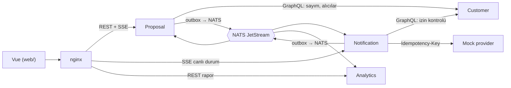
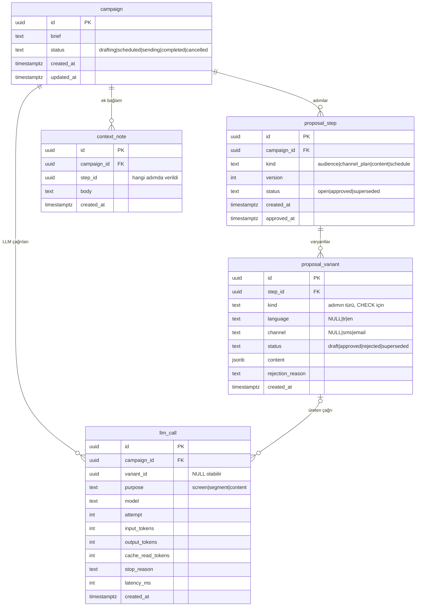
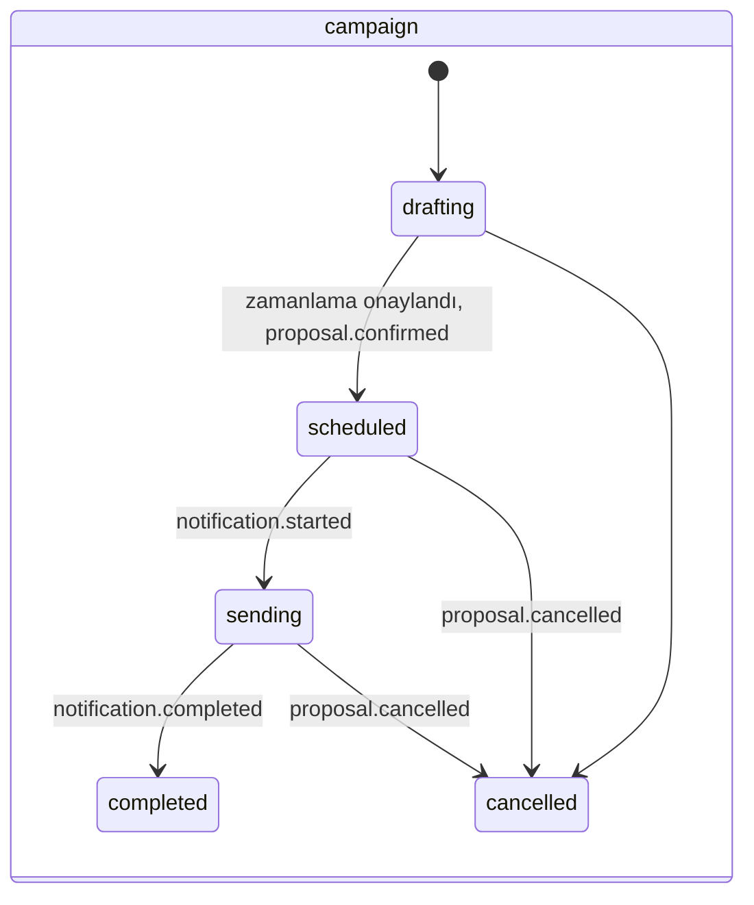
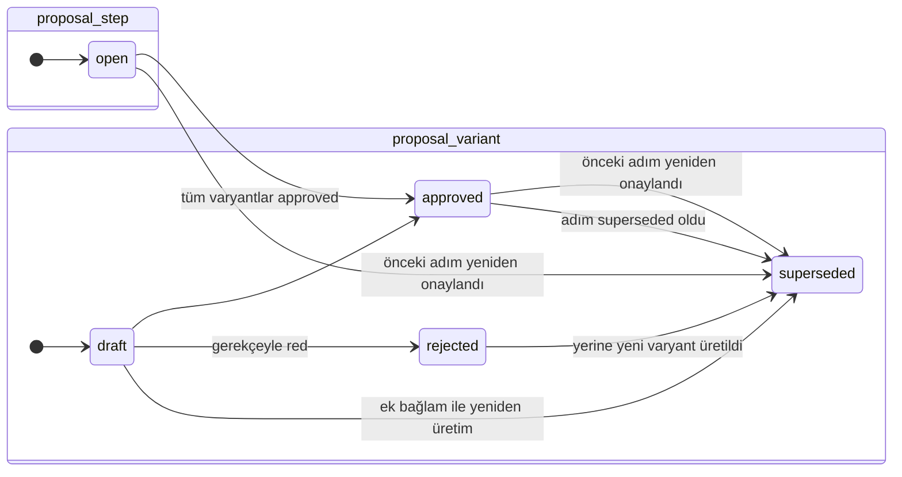
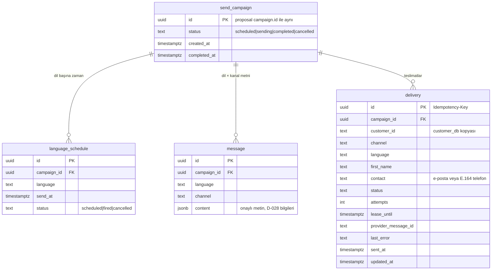
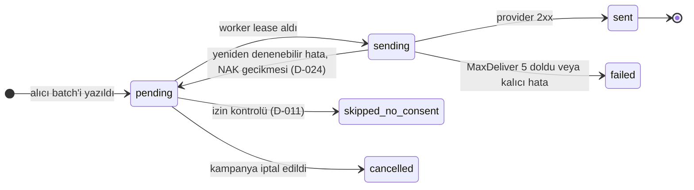
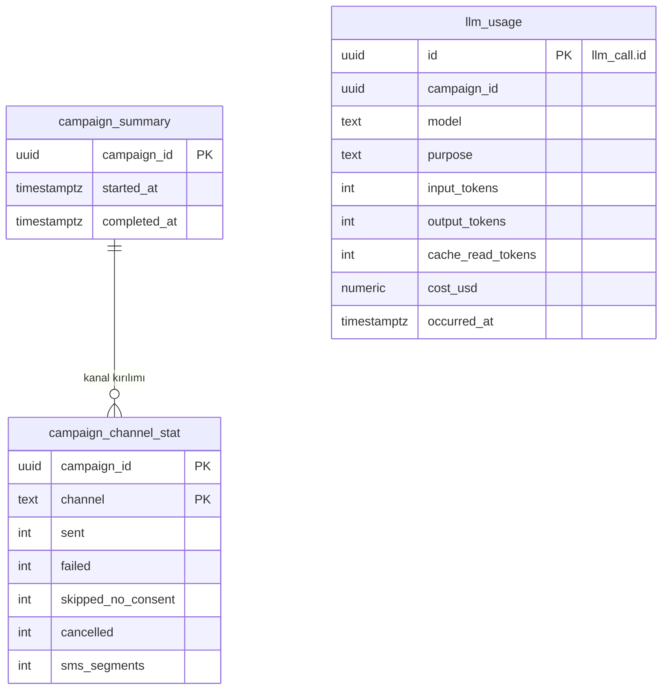
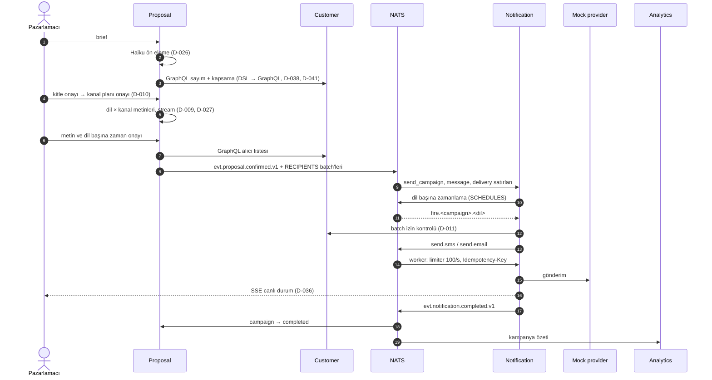

# Domain modeli

Smart Campaign Composer'ın servisleri, veri modelleri, durum makineleri ve olay sözleşmeleri. Gerekçeler [DECISIONS.md](../DECISIONS.md) içindedir; bu belge yapının kendisini anlatır. `customer_db` için ayrıntı [database-architecture.md](database-architecture.md).

> **Durum (2026-10-27):** Tasarım belgesi, henüz kod veya migration yok (D-029).
> - **Kesin:** karar numarası verilen her şey. Örnekler: tablo sınırları, durum değerleri, unique kısıt, stream'ler, zarf.
> - **Taslak:** "taslak" işaretli kolon listeleri, `content` şemaları, olay `data` alanları ve kısıt önerileri. Bunlar migration yazılırken kullanıcıyla kesinleşir (CLAUDE.md, Kodlama kuralları §7).

## 1. Servisler ve sahiplik

| Servis | Veritabanı / rol | Sahip olduğu kavramlar | Yayınlar | Tüketir |
|---|---|---|---|---|
| Customer | `customer_db` / `customer_svc` | Müşteri, ürün, sipariş, sepet, olay, izin (D-004) | — | — |
| Proposal | `proposal_db` / `proposal_svc` | Kampanya, teklif adımı, varyant, ek bağlam, LLM çağrısı (D-022) | `proposal.confirmed`, `proposal.cancelled`, `proposal.token_completed`; alıcı batch'leri | `notification.*` (kampanya durumu, D-033) |
| Notification | `notification_db` / `notification_svc` | Gönderim kampanyası, dil zamanlaması, mesaj, teslimat (D-023) | `notification.started`, `notification.completed` | `proposal.*`, alıcı batch'leri, zamanlama tetikleri, `send.*` |
| Analytics | `analytics_db` / `analytics_svc` | Kampanya özeti, LLM kullanımı ve maliyeti (D-036) | — | `notification.completed`, `proposal.token_completed` |
| Mock provider | DB yok | Idempotency yanıt önbelleği (bellekte, taslak) | — | — |

Senkron çağrılar yalnız Customer'ın GraphQL'ine gider: Proposal kitle sayımı ve alıcı listesi için (D-007), Notification gönderim öncesi izin kontrolü için (D-011). Erişim her durumda bu uç noktada zorlanır: her servis kendi token'ı ve kapsamıyla çağırır, alan beyaz listesi sunucudadır ve nginx Customer'ı dışarı açmaz (D-042, D-043). Canlı durum, Notification'dan SSE ile gelir (D-036). Diğer her şey NATS'tir (D-006).



## 2. Ortak kurallar

- **Kimlik:** yeni tablolarda `id uuid DEFAULT uuidv7()` (D-030). Olay id'si ve `Idempotency-Key` de UUIDv7.
- **Servisler arası referans:** başka servisin kimliği yabancı anahtar değil, düz kolondur. Örnek: `delivery.customer_id`, `customer_db`'deki `customer_id`'nin kopyasıdır. Veritabanları arası `JOIN` yok (D-003).
- **Zaman:** tüm zaman damgaları `timestamptz`, UTC.
- **Outbox:** olay yayınlayan her servisin DB'sinde `outbox` tablosu. Olay, iş satırıyla aynı transaction'da yazılır ve relay NATS'e taşır (D-006).
- **Tüketici dedup'u:** olay tüketen her serviste `processed_event(event_id PRIMARY KEY, processed_at)`. Olayı işleyen transaction'da önce buraya yazılır; çakışma olursa olay atlanır (D-023).
- **Sabit değerler:** dil `tr | en` ve kanal `sms | email`, `customer_db` ile aynıdır.

`outbox` (taslak): `id uuid` (olay id'si), `subject`, `payload jsonb` (zarf, §6), `created_at`, `published_at NULL`.

### Servis platformu (D-031, D-050)

Her Go servisi `internal/platform/` paketlerini kullanır:

| Paket | Sağladığı |
|---|---|
| `config` | Viper: koddaki varsayılanlar, çalışma dizinindeki isteğe bağlı `.env`, sonra öneksiz ortam değişkenleri (ortam önceliklidir); `Require` eksik anahtarları tek hatada toplar |
| `logging` | `log/slog` JSON logger, seviye `LOG_LEVEL` |
| `health` | `/healthz` (yalnız süreç) ve `/readyz` (kayıtlı kontroller eşzamanlı, kontrol başına 2 sn; JSON `{status, checks}`, başarısızlıkta 503) |
| `metrics` | Servise özel Prometheus registry, Go ve process collector'ları, `http_requests_total{method,route,status}`, `http_request_duration_seconds{method,route}` |
| `httpserver` | chi router (RequestID → istek logu → metrik → Recoverer), `/healthz`, `/readyz`, `/metrics`; `WriteTimeout`'suz sunucu (SSE) ve bağlam iptalinde zarif kapanış |

Ortak anahtarlar: `HTTP_ADDR` (`:8080`), `LOG_LEVEL` (`info`), `SHUTDOWN_TIMEOUT` (`10s`). Servise özel anahtarlar (`DATABASE_URL`, `NATS_URL` …) servis görevlerinde eklenir.

## 3. proposal_db



Kolon listeleri taslaktır. Tablo sınırları, adım türleri ve durum değerleri kesindir (D-022, D-033, D-034).

### Varyant biçimi (D-034)

| Adım türü | Varyant sayısı | `language` | `channel` |
|---|---|---|---|
| `audience` | 1 | NULL | NULL |
| `channel_plan` | 1 | NULL | NULL |
| `content` | kitledeki her dil × plandaki her kanal (yalnız alıcısı olan çiftler, D-010) | dolu | dolu |
| `schedule` | kitledeki her dil (D-009) | dolu | NULL |

Önerilen `CHECK` (taslak):

```sql
CHECK (
  (kind IN ('audience', 'channel_plan') AND language IS NULL AND channel IS NULL)
  OR (kind = 'content'  AND language IS NOT NULL AND channel IS NOT NULL)
  OR (kind = 'schedule' AND language IS NOT NULL AND channel IS NULL)
)
```

`content` alanının şeması adım türüne göre değişir (taslak, açık konu):

| Tür | `content` (taslak) |
|---|---|
| `audience` | `{dsl, graphql, count, coverage: {both, email_only, sms_only, unreachable, by_language}}`: DSL ve çevirisi (D-007), SQL'le hesaplanan sayım ve kapsama (D-010) |
| `channel_plan` | `{mode: single \| primary_fallback \| both, primary: sms \| email, counts}` (D-010) |
| `content` / sms | `{text, encoding: gsm7 \| ucs2, segments, max_rendered_length}` (D-028) |
| `content` / email | `{subject, body}`; gövde biçimi HTML email kararına bağlı (açık) |
| `schedule` | `{send_at}`; `null` hemen gönderim demek |

### Durum makineleri (D-033, D-022)





Kurallar:

- Adım sırası `audience → channel_plan → content → schedule`. Bir adım, öncekinin `approved` sürümü olmadan açılmaz.
- Kitle yeniden onaylanırsa `channel_plan`, `content` ve `schedule` superseded olur. Kanal planı değişirse yalnız `content` ve `schedule` superseded olur (D-010).
- Ek bağlam (D-009) bir `context_note` yazar. Açık adımın onaylanmamış varyantları superseded olur ve yeniden üretilir; onaylı varyantlar korunur.
- Red yalnız o varyantı yeniden üretir (D-009). Yeni varyant aynı adımda açılır, `version` artmaz.
- Güncel adım: `status = 'open'` olan, yoksa son `approved` adım. Kampanyada saklanmaz (D-033).
- Satırlar silinmez. Önerilen kısıt (taslak): bir kampanyada her tür için en fazla bir adım `superseded` dışında olabilir (kısmi unique indeks).

## 4. notification_db



Tablo adları ve kolonlar taslaktır. `send_campaign` adı, Proposal'daki `campaign`'den ayırmak için seçildi. `customer_id`, `customer_db`'deki gibi `text`'tir.

Kesin olanlar (D-023):

- `UNIQUE (campaign_id, customer_id, channel)`; alıcı batch'leri `ON CONFLICT DO NOTHING` ile yazılır.
- `Idempotency-Key` = `delivery.id`.
- Notification kanal seçmez. Her alıcı Proposal'ın atadığı kanalla gelir (D-010).



`skipped_no_consent` kişi diğer kanala düşürülmez (D-011). Customer'a ulaşılamazsa satır `pending` kalır ve ertelenir; izni doğrulanmamış kimseye gönderim yapılmaz (fail-closed).

Canlı dashboard bu tablonun `campaign_id, channel, status` kırılımındaki anlık sayımlarını SSE ile yayar (D-036).

## 5. analytics_db

Taslak; yalnız sınırı kesin (D-036): olaylardan kampanya özeti ve LLM kullanımı.



Analytics bir olayı birden çok kez alabilir. Bu yüzden `processed_event` dedup'u ve `llm_usage.id = llm_call.id` birincil anahtarı birlikte tekrarı engeller.

## 6. NATS sözleşmeleri

### Stream'ler (D-024, D-049)

| Stream | Saklama | Konular | İçerik |
|---|---|---|---|
| `EVENTS` | limits, 7 gün | `evt.>` | Servisler arası olaylar; servis başına durable tüketici |
| `RECIPIENTS` | work-queue | `recipients.>`; kampanya başına alt konu `recipients.<campaign_id>` taslak | Alıcı batch'leri; Notification DB'ye yazıp ack verince silinir |
| `SCHEDULES` | limits, süresiz, `AllowMsgSchedules` | `sched.>` ve `fire.>`; `sched.<campaign_id>.<language>` → `fire.<campaign_id>.<language>` biçimi taslak | Dil başına tek zamanlama; tetiklenince hedef konuya ileti düşer |
| `SEND` | work-queue | `send.sms`, `send.email` | Teslimat başına ileti, `{delivery_id}` |

Stream'lerin hepsi dosya depolamalı, tek replikalı; dedup penceresi 2 dakika, ileti sınırı 1 MB. Tanımlar `infra/nats/streams/*.json` dosyalarındadır; compose'daki tek seferlik `nats-init` konteyneri her `up`'ta bunları oluşturur veya günceller. Servisler stream oluşturmaz (D-049).

İptal API'si olmadığı için tetiklenen `fire.*` iletisini işleyen worker, `send_campaign` ve `language_schedule` durumunu kontrol eder. İptal edilmişse iletiyi düşürür (D-006).

### Zarf (D-035)

```json
{
  "id": "0199f3a2-7c4e-7b1a-9d2e-5f6a7b8c9d0e",
  "type": "proposal.confirmed",
  "version": 1,
  "occurred_at": "2026-10-27T09:00:00Z",
  "producer": "proposal",
  "correlation_id": "0199f3a1-0000-7000-8000-000000000001",
  "data": {}
}
```

- Konu `evt.<servis>.<olay>.v1`; `id`, `Nats-Msg-Id` header'ı olarak da gönderilir.
- `correlation_id` kampanya id'sidir.
- Sürüm içinde yalnız alan eklenir; kırıcı değişiklik `.v2` konusuna gider.

### Olay kataloğu (taslak)

| Konu | Üretici → tüketici | `data` (taslak) |
|---|---|---|
| `evt.proposal.confirmed.v1` | Proposal → Notification | `campaign_id`, `schedules[{language, send_at}]`, `messages[{language, channel, content}]`, `recipient_batches` |
| `evt.proposal.cancelled.v1` | Proposal → Notification | `campaign_id`, `reason` |
| `evt.proposal.token_completed.v1` | Proposal → Analytics | `llm_call` satırı: `id`, `campaign_id`, `model`, `purpose`, token sayıları |
| `evt.notification.started.v1` | Notification → Proposal, Analytics | `campaign_id`, `language`, `started_at` |
| `evt.notification.completed.v1` | Notification → Proposal, Analytics | `campaign_id`, kanal ve durum sayıları, `sms_segments` |

Alıcı batch'i (`RECIPIENTS`, taslak): `{campaign_id, batch_no, batch_count, recipients[{customer_id, first_name, language, channel, contact}]}`. NATS'in 1 MB ileti sınırı batch boyutunu belirler (D-008'den korunan bedel).

Alıcı listesi Proposal'dan geçer. Proposal listeyi Customer GraphQL'inden alır ve onaylı kanal planına göre her kişiye kanal atar (D-010). Listenin hangi anda alınacağı ve Proposal'da kalıcı saklanıp saklanmayacağı açık; aşağıdaki akış zamanlama onayından sonrasını varsayar.

## 7. Uçtan uca akış



## 8. Açık noktalar

DECISIONS.md'nin "Açık konular" listesine ek olarak bu belgede taslak kalanlar:

- Tüm tabloların kolon listeleri, kısmi unique indeks ve `CHECK` önerileri (migration yazılırken).
- `proposal_variant.content` şemaları; HTML email gövde biçimi.
- Olay `data` alanları ve `RECIPIENTS` / `SCHEDULES` konu adları.
- Proposal'ın alıcı listesini hangi anda aldığı ve kalıcı saklayıp saklamayacağı.
- Mock provider'ın idempotency önbelleğinin bellekte mi tutulacağı.
