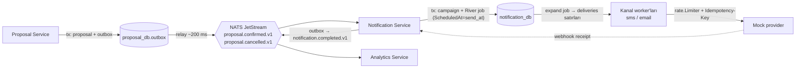

# Araştırma 1 — Gönderim hattı: kuyruk, olaylar, zamanlama, rate limit, retry, mock provider

> **Durum:** Araştırma bulgusu, karar değil. Buradaki öneriler DECISIONS.md'ye ancak kullanıcı onayıyla `Kabul edildi` olarak girer.
> **Tarih:** 2026-10-27 · **Kaynak sorular:** THOUGHTS.md (§8 Scheduling, §9 Notification Service, GOALS: eventual consistency, p95 200 ms), DECISIONS.md açık konular (kuyruk, rate limit, idempotency, retry, mock provider oranları).

## Özet öneri

| Konu | Öneri | Neden |
|---|---|---|
| Servisler arası olaylar | **NATS JetStream** (tek konteyner) + her servis DB'sinde **transactional outbox** | Servis başına DB'yi bozmadan gerçek event-driven tasarım; compose'a eklenecek en ucuz broker |
| Notification içi iş kuyruğu | **River** (Postgres, `notification_db` içinde) | İş, iş satırıyla aynı transaction'da kuyruğa girer; retry, `ScheduledAt`, cancel hazır |
| Zamanlamanın sahibi | **Notification Service** | Rate limit, gönderim anı izin kontrolü, retry ve iptal yarışları zaten orada |
| Rate limit | Kanal başına süreç içi `x/time/rate`, tek worker replikası | 100 msg/s ölçeğinde dağıtık limiter gereksiz |
| "İki kez gitmez" | `UNIQUE(campaign_id, customer_id, channel)` + durum makinesi + `Idempotency-Key` header | Kuyruk en az bir kez teslim eder; tekillik veritabanında zorlanır |

## 1. Hedef akış



THOUGHTS.md'deki olay adları (`proposalOnConfirm`, `notificationOnComplete`, `tokenOnComplete`) şu konulara karşılık gelir: `proposal.confirmed.v1`, `proposal.cancelled.v1`, `notification.completed.v1`, `token.completed.v1`.

## 2. Kuyruk teknolojisi

| Seçenek | Uygunluk / bedel |
|---|---|
| **River** (önerilen, iş kuyruğu) | v0.49.0 (2026-10-05). İşi iş satırıyla aynı transaction'da ekler; `NextRetry`, `JobSnooze` (deneme hakkı yemez), `JobCancel`, `ScheduledAt`, kuyruk başına `MaxWorkers`. En az bir kez teslim; unique-jobs yalnızca ekleme anında geçerli. Yerleşik rate limit bulunamadı. |
| Elle `FOR UPDATE SKIP LOCKED` | Postgres dokümanı kuyruk tabloları için açıkça önerir; ~100 satır. Retry, lease, iptal ve metrikleri kendin yazarsın. |
| asynq (Redis) | v0.26.0; yaşıyor ama yavaş. Redis konteyneri ve kalıcılık ayarı gerekir; DB yazımıyla aynı transaction'da kuyruğa eklenemez. |
| NATS JetStream | Olaylar için güçlü (§8). Mesaj başına iş kuyruğu olarak retry/rate/durum mantığını kendin kurarsın. |
| RabbitMQ | Olgun ama en ağır konteyner; Postgres ile transactional ekleme yok, gecikmeli mesaj desteği değişiyor (§5). |

Birkaç bin alıcı ve toplam 200 msg/s, Postgres tabanlı kuyruğun sınırlarının çok altında.

## 3. Rate limit: kanal başına 100 msg/s

- Kanal başına `rate.NewLimiter(rate.Limit(90), 5)`, HTTP çağrısından hemen önce `Wait(ctx)`.
- Token bucket herhangi bir `t` penceresinde yaklaşık `r·t + burst` olaya izin verir. Burst 100 olursa 1 sn'de ~200 gidebilir. "En fazla 100/sn"yi sıkı tutmak için burst küçük (1–5), hız 100'ün biraz altında.
- Eşzamanlılık ≈ hız × gecikme: 100/sn × 200 ms ≈ 20 uçuşta istek. Kanal başına `MaxWorkers` 25–40; her kanal ayrı River kuyruğu, böylece biri diğerini aç bırakmaz.
- **429 tepkisi:** `Retry-After`'ı hem saniye hem HTTP tarihi olarak ayrıştır (RFC 9110). Kanal genelinde atomik bir `pausedUntil` zamanı tut; tüm worker'lar `Wait`'ten önce bakar. İşi `JobSnooze(retryAfter + jitter)` ile ertele, deneme hakkı yanmasın. İsteğe bağlı: kanal hızını yarıya indir, sonra kademeli geri artır.

| Alternatif | Bedel |
|---|---|
| Redis GCRA (`go-redis/redis_rate`) | Replikalar arası doğru, ama sadece bunun için Redis eklenir; son sürümü doğrulanamadı. |
| Postgres'te token-bucket satırı | Yeni altyapı yok; her gönderim tek satırda çekişir. |
| Replika başına 100/N | Basit; boştaki replikalar kapasiteyi boşa harcar. |

## 4. Idempotency ve "aynı kişiye iki kez gitmez"

- **Anahtar:** `deliveries` tablosunda `UNIQUE(campaign_id, customer_id, channel)`; fan-out `ON CONFLICT DO NOTHING`. Provider'a `Idempotency-Key: <delivery uuid>` gönderilir; e-posta veya telefon anahtara girmez.
- **Durumlar:** `pending → sending → sent | failed | unknown`, ayrıca `skipped_no_consent`.
- **Sahiplenme (claim):**
  ```sql
  UPDATE deliveries d SET status = 'sending', lease_until = now() + interval '30 seconds'
  FROM campaigns c
  WHERE d.id = $1 AND d.campaign_id = c.id
    AND d.status IN ('pending', 'retry') AND c.status = 'active';
  -- 0 satır → atla
  ```
  Lease'i dolmuş `sending` satırı aynı anahtarla yeniden denenir.
- **Provider kabul etti ama yanıt kayboldu:** aynı anahtarla yeniden dene. Mock provider anahtar → yanıt eşlemesini saklar ve aynı yanıtı döner (Stripe modeli; anahtarlar 24 saatte budanır). Retry ufku provider'ın anahtar saklama süresinden kısa olmalı.
- **Teslim anlamı:** provider tarafında dedup varsa denemeler en az bir kez, teslim fiilen bir kez olur. Dedup olmayan gerçek SMS API'lerinde belirsiz timeout `unknown` yapılır ve receipt ile uzlaştırılır, otomatik yeniden gönderilmez. Pazarlama için bu "en fazla bir kez" tercihi daha güvenlidir.
- **İzin, gönderim anında kontrol edilir** (claim adımında), zamanlama anında değil; arada geri çekilmiş olabilir.

Referans: IETF `Idempotency-Key` header'ı hâlâ taslak (draft-08); eşzamanlı aynı anahtar için 409, aynı anahtar farklı gövde için 422 önerir.

## 5. Zamanlama: sahibi ve iptal

**Öneri:** Proposal, `send_at` alanlı (`null` = hemen) `proposal.confirmed.v1` yayınlar. Notification kampanyayı kaydeder ve aynı transaction'da `ScheduledAt = send_at` olan bir River "expand-campaign" işi ekler. Bu iş `deliveries` satırlarını idempotent biçimde üretir. Proposal ince bir CRUD + LLM servisi kalır; bu, LLM dışı uç noktalarda p95 ≈ 200 ms hedefine de yardım eder.

| Seçenek | Bedel |
|---|---|
| **River `ScheduledAt`** (önerilen) | Zamanlama satırıyla aynı transaction'da, iptal edilebilir, DB'de görünür. Zaman hassasiyeti fetch aralığıyla sınırlı. |
| Zamanlama tablosu üzerinde poller | En basit ve açık; gecikme = poll aralığı, lease'leri sen yazarsın. River fiilen budur. |
| NATS JetStream zamanlanmış mesajlar | 2.12'den beri var, 2.14 cron ekledi. Stream bayrağı geri alınamaz; konu başına tek zamanlama; belgelenmiş iptal API'si bulunamadı. Doğruluk kaynağı olarak zayıf. |
| RabbitMQ gecikme | Delayed-message eklentisi 2026-09-24'te arşivlendi; quorum-queue gecikmesi 4.4'te (2026-10-20) yeni geldi. Bahis için fazla taze. |

**İptal:** `proposal.cancelled.v1` gelince tek transaction'da `campaigns.status = 'cancelled'` ve expand işi için `JobCancel`. Kuyruktaki iş atomik iptal olur, çalışan iş sadece sinyal alır ve yapılmış yan etkiler geri alınmaz. Bu yüzden her gönderim claim adımında kampanya durumunu yeniden kontrol eder (§4).

**Zamanlayıcı ve retry çakışması:** unique kısıt fan-out tekrarını güvenli yapar; claim + lease eşzamanlı gönderimi engeller; River unique args (`campaign_id`) çift expand işini yalnızca ekleme anında engeller.

## 6. Retry politikası

- **Yeniden dene:** 429, 500/502/503/504, 408, timeout, bağlantı reset/refused (belirsiz olanlar aynı idempotency anahtarıyla). 409'u (aynı anahtar uçuşta) kısa süre yeniden dene.
- **Deneme:** 400, 401, 403, 404, 422 → `failed` + sebep.
- **Gecikme:** `delay = max(retryAfter, rand(0, min(cap, base·2^n)))`; base 2 sn, çarpan 2, cap 60 sn, taban 250 ms. River'ın varsayılan `NextRetry`'ı (deneme⁴ sn, 25 deneme) ezilir.
- **Deneme sayısı:** demoda 6 (en kötü ~2 dk). Üretimde saatlere yayılan 8–10, ama yalnızca provider anahtar saklama süresi yetiyorsa.
- **Neden tam jitter:** AWS analizine göre jitter'sız backoff en çok işi yapıyor; tam jitter, eşit jitter'dan daha az iş ve daha kısa süre.
- **Retry bütçesi:** Google SRE tek katmanda en fazla 3 deneme ve trafiğin ~%10'undan az retry öneriyor. Ek olarak kanal devre kesicisi: son hata oranı yüksekse kanalı duraklat.
- **Dead letter:** son denemeden sonra `deliveries.status = 'failed'` + `last_error`; dashboard'da görünür, aynı anahtarla "başarısızları yeniden kuyruğa al" eylemi.

## 7. Mock provider

- Kanal başına HTTP servisi (veya yol öneki), seed'li hata enjeksiyonu ve **kendi rate limiter'ı** (~110/sn, gerçek 429 + `Retry-After`). Böylece bizim limiter'ın provider sınırının altında kaldığı kanıtlanır.
- **Önerilen oranlar** (yargıya dayalı; yetkili bir kaynak bulunamadı):

  | Davranış | Oran |
  |---|---|
  | 5xx | %2–3 |
  | İstemci timeout'unu (3 sn) aşan takılma | %1–2 |
  | 429 + `Retry-After: 1–3` | %1–2 |
  | Kalıcı 400 | %1 |
  | İşle, sonra bağlantıyı düşür (idempotency testi) | %1 |
  | Gecikme | p50 ≈ 80 ms, %3–5 kuyruk 1–2 sn |

- **Deterministik mod:** PCG'yi `hash(Idempotency-Key + deneme no)` + global `MOCK_SEED` ile tohumla; sonuç goroutine sırasına bağlı olmaz. Testler için `X-Mock-Fault: 503|429|timeout|drop` header'ı ve oranları değiştiren bir config uç noktası.
- **Idempotency:** anahtar → yanıt 24 saat saklanır ve tekrar döndürülür. "Fiilen teslim edilen" tekil mesaj sayacı açılır; testler alıcı başına tam bir teslimi doğrular.
- **Receipt:** 202 + provider mesaj id'si, rastgele gecikmeyle imzalı webhook (`delivered` / `failed`). Ara sıra receipt'i çift veya sırasız gönder; webhook işleyicisi idempotent olmalı. Senkron durum daha basit ama webhook eventual consistency'yi ve canlı durumu gösterir.
- Toxiproxy (latency, timeout, reset_peer) isteğe bağlı; `make test` için mock içi enjeksiyon yeterli.

## 8. Olay altyapısı (bir haftalık plan)

- **Neden servisler arası Postgres kuyruğu değil:** River tek veritabanı içinde çalışır; transaction'ı servis DB'leri arasında geçmez. Tek DB paylaşmak servis başına DB ilkesini bozar.
- **Outbox:** `outbox(id uuid, type, version, payload jsonb, created_at, published_at)` iş transaction'ında yazılır. Relay goroutine ~200 ms'de bir `SKIP LOCKED` ile okur, `Nats-Msg-Id = outbox.id` ile yayınlar, PubAck'i bekler, `published_at`'i işaretler. Relay iki kez yayınlayabilir.
- **Dedup:** JetStream'in yinelenen mesaj penceresi varsayılan 2 dakika, yani kısmi koruma. Asıl garanti tüketicide: tek transaction'da `INSERT INTO processed_events(event_id) ON CONFLICT DO NOTHING`, işi yap, commit, ack.
- **Tüketiciler:** dayanıklı pull consumer, açık ack.
- **Adlandırma:** `proposal.confirmed.v1` gibi konular; zarf `{id, type, version, occurred_at, producer, correlation_id, data}`. Sürüm içinde yalnızca ekleme; kırıcı değişiklik `.v2` konusu.
- **Süre kısalırsa kesme sırası:** webhook receipt → Analytics tüketicisi (doğrudan sorgu) → ayrı Analytic DB. Outbox ve idempotent tüketiciler kalır; brief'in puanladığı yer orası. NATS gecikirse yedek: outbox'u ortak bir okuma API'si üzerinden poll etmek (broker kaybolur, sözleşmeler aynı kalır).

## 9. Metrikler ve sağlık

- `prometheus/client_golang` + `promhttp`.
- **Metrikler:** `deliveries_total{channel,status}`, `provider_requests_total{channel,code_class}`, `provider_429_total{channel}`, `retries_total{channel,reason}`, `send_latency_seconds{channel}` (histogram), `queue_depth{queue,state}` (periyodik `count … GROUP BY state` ile gauge), `rate_limiter_wait_seconds{channel}`, `channel_paused{channel}`, `outbox_pending`, `outbox_lag_seconds`, `event_consume_total{type,result}`, `dlq_total`.
- Yüksek hacimli serilere `campaign_id` / `customer_id` etiketi konmaz.
- **Uç noktalar:** `/healthz` (liveness, yalnızca süreç), `/readyz` (kendi DB'si, migration'lar, broker bağlantısı, worker'lar başladı), `/metrics`. Mock provider'ın erişilebilirliği readiness koşulu değil; metrik ve "degraded" bayrağı olarak gösterilir. Compose'da `healthcheck: /readyz` + `depends_on: condition: service_healthy`.

## Doğrulanamayanlar

- Sürüm numaraları pkg.go.dev'den; bazı sayfalar "daha yeni sürüm var" uyarısı verdi. Sabitlemeden önce `go list -m -u all`.
- River'ın yerleşik rate limit / Prometheus exporter'ı ve `JobSnooze` üst sınırı doğrulanmadı.
- NATS ack/`AckWait`/`MaxDeliver` ayrıntıları ve 2 dk dedup penceresi resmi referanstan değil, genel bilgi ve arama özetlerinden.
- Mock provider oranları öneridir, ölçülmüş kıyas değildir.

## Kaynaklar

- River: https://pkg.go.dev/github.com/riverqueue/river · https://riverqueue.com/docs/unique-jobs · https://riverqueue.com/docs/transactional-enqueueing · https://riverqueue.com/docs/job-retries · https://riverqueue.com/docs/cancelling-jobs
- Postgres SKIP LOCKED: https://www.postgresql.org/docs/18/sql-select.html#SQL-FOR-UPDATE-SHARE
- asynq: https://github.com/hibiken/asynq
- Rate limit: https://pkg.go.dev/golang.org/x/time/rate · https://github.com/go-redis/redis_rate
- HTTP: https://www.rfc-editor.org/rfc/rfc6585#section-4 · https://www.rfc-editor.org/rfc/rfc9110#section-10.2.3
- Idempotency: https://docs.stripe.com/api/idempotent_requests · https://datatracker.ietf.org/doc/draft-ietf-httpapi-idempotency-key-header/ · https://brandur.org/idempotency-keys
- Retry: https://aws.amazon.com/blogs/architecture/exponential-backoff-and-jitter/ · https://sre.google/sre-book/handling-overload/ · https://www.twilio.com/docs/api/errors/20429
- Zamanlama: https://www.synadia.com/blog/delayed-message-scheduling-nats-jetstream · https://nats.io/blog/nats-server-2.14-release/ · https://github.com/rabbitmq/rabbitmq-delayed-message-exchange · https://www.rabbitmq.com/blog/2026/10/20/rabbitmq-4.4-release
- Outbox ve NATS: https://microservices.io/patterns/data/transactional-outbox.html · https://docs.nats.io/reference/jetstream/api/headers · https://pkg.go.dev/github.com/nats-io/nats.go/jetstream
- Chaos: https://github.com/Shopify/toxiproxy
- Metrik/sağlık: https://pkg.go.dev/github.com/prometheus/client_golang/prometheus · https://kubernetes.io/docs/tasks/configure-pod-container/configure-liveness-readiness-startup-probes/
