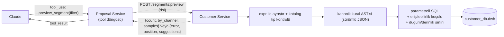

# Araştırma 2 — Kitle sorgusu: GraphQL, MCP ve JS benzeri filtre dili

> **Durum:** Araştırma bulgusu, karar değil. Öneriler DECISIONS.md'ye ancak kullanıcı onayıyla girer.
> **Tarih:** 2026-10-27 · **Kaynak sorular:** THOUGHTS.md §2 (2.1 GraphQL + MCP + JS benzeri DSL, 2.2 REST + structured output, 2.3 erişilebilirlik koşulu), GOALS (çıktı token verimliliği, GraphQL ile customer service, DSL → GQL JSON), diyagramdaki "GQL with MCP or similar viable?" sorusu.

## Sonuç

Bir haftalık yapım için **MCP'yi atla, GraphQL'i isteğe bağlı tut**. Önerilen yol THOUGHTS.md'deki seçeneklerin melezi:

- Model, **kapalı bir alan kataloğuna** karşı JS benzeri kısa bir boolean ifade yazar (`city == "İstanbul" && sms_opt_in && cart.added_within_days(30) && !order.within_days(30)`).
- İfadeyi Proposal Service'in tanımlayıp kendisinin çalıştırdığı **sıradan bir istemci tarafı tool** taşır (`preview_segment(filter: string)`).
- Customer Service ifadeyi ayrıştırır, katalogla tip kontrolü yapar, **kanonik kural AST'sine** çevirir ve **parametreli SQL**'e derler. LLM çıktısı hiçbir zaman SQL olarak çalışmaz.
- Erişilebilirlik koşulu (THOUGHTS 2.3) derleyici tarafından, kullanıcının ağacının **dışına** eklenir; hiçbir filtre onu kaldıramaz.

Bu, mock LLM ile docker-compose içinde kolayca test edilebilen tek seçenek.



## 1. MCP doğru köprü mü?

**Hayır, bu yapım için değil.**

- **Claude API MCP connector** (beta, `mcp-client-2025-11-20`; `mcp-client-2026-09-15` tool listesi sabitlemeyi ekliyor): sunucu herkese açık ve `https://` olmalı, yerel STDIO sunucu kullanılamaz, MCP spec'inden yalnızca tool çağrıları desteklenir, ZDR kapsamında değil. Bu, Anthropic sunucularının müşteri ambarının önündeki **herkese açık bir uç noktayı** çağırması demek: docker-compose demosu için yanlış, ayrıca GDPR açısından sorun. Mock LLM connector'ı çalıştıramaz.
- **İstemci tarafı tool use** (önerilen): Go tool'ları tanımlar, `tool_use` geldikçe çalıştırır, `tool_result` döner. En basit ve en test edilebilir yol; mock LLM yalnızca `tool_use` bloklarını tekrar oynatır.
- **Proposal'da Go MCP istemcisi, Customer'da MCP sunucusu** (docker ağı içinde): mimari olarak şık, "MCP-hazır" görünür, ama işlevsel kazanç olmadan bir protokol katmanı ekler. Ancak zaman kalırsa.

Go SDK'ları: resmi `modelcontextprotocol/go-sdk` v1.8.0 (2026-09-04, spec 2026-07-28 desteği), `mark3labs/mcp-go` v1.4.0 (çok aktif). MCP kullanılırsa resmi SDK tercih edilmeli.

**GraphQL → MCP köprüleri** (Apollo MCP Server 2.1.0, `blurrah/mcp-graphql`): ikisi de modele serbest GraphQL çalıştırma verir; erişilebilirlik zorlanmaz, PII açığa çıkar. `mcp-graphql`'in kendi README'si üretim için kilitli özel sunucu öneriyor. Uygun değil.

## 2. GraphQL (Customer Service)

**Yapılacaksa gqlgen** (v0.17.98, 2026-10-22, MIT, hâlâ 0.x). `graph-gophers/graphql-go` (v1.10.3) codegen'siz, daha hafif ama daha az tip güvenli. Hasura/PostGraphile sidecar'ı `where` girdilerini otomatik üretir ama `customer_db`'ye üçüncü bir servis bağlar; "yalnızca Customer Service bağlanır" kuralını (D-003) bozar.

Filtre modeli, Hasura tarzı özyinelemeli girdi tipleri:

```graphql
input CustomerBoolExp {
  _and: [CustomerBoolExp!]  _or: [CustomerBoolExp!]  _not: CustomerBoolExp
  city: StringCmp  sms_opt_in: BoolCmp
  cart_items: CartItemBoolExp   # ilişki → EXISTS
  orders: OrderBoolExp
}
input StringCmp { _eq: String  _in: [String!]  _is_null: Boolean }
```

- Sayfalama: `customer_id` üzerinde keyset + `limit`; Relay connection gereksiz. Sayım: `customers_aggregate(where){count}`.
- **Güvenli derleme:** `where` ağacını Go'da gez; alan adı → (kolon, tip, izinli operatörler) sabit haritası, `$n` placeholder'ları, tanımlayıcı asla string olarak eklenmez. İlişki, sabit bir `EXISTS (SELECT 1 FROM dwh.fact_cart_item … WHERE customer_id = c.customer_id AND …)` şablonuna gider. Salt-okunur transaction + `statement_timeout`.
- **Maliyet/derinlik:** gqlgen'de `extension.FixedComplexityLimit` ve alan başına karmaşıklık fonksiyonları var; derinlik sınırı ve introspection kapatma dokümanda yok. Kütüphaneden bağımsız olarak kendi AST doğrulayıcında düğüm sayısı (≤ ~30), derinlik (≤ 5) ve en fazla `EXISTS` sayısı zorlanmalı.
- Hazır "gqlgen Hasura where → SQL" üreticisi bulunamadı; derleyici elle ~200–300 satır.

## 3. JS benzeri ifade dili

**Öneri: `expr-lang/expr`**, AST'si kanonik kural AST'sine gezilerek.

| Kütüphane | Durum | Not |
|---|---|---|
| **expr-lang/expr** | v1.17.8 (2026-02-14), kararlı | `parser.Parse` + `ast.Walk` / `Visitor`. `expr.Env(...)` + `expr.AsBool()` ile tip kontrolü; **asla `Run` çağrılmaz**, yalnızca derlenir. `cart.added_within_days(30)` gibi yardımcılar AST'de `CallNode` (callee `MemberNode`) olarak görünür ve `EXISTS` şablonuna eşlenir. Derlenmiş programdan alınan AST optimizer tarafından değiştirilmiş olabilir; ham `parser.Parse` çıktısı kullanılmalı. |
| CEL (`cel.dev/cel-go`) | v0.32.0 (2026-08-19) | Daha sıkı tip denetleyici ve `exists`/`all` makroları, daha ağır API. `google/cel-go` artık salt-okunur uyumluluk deposu. v0.28.1–v0.29.2 GO-2026-6094 açığı taşır; ≥ v0.30 sabitlenmeli. Önceki çalışma: `spandigital/cel2sql/v3` (parametreli Postgres çıktısı, derinlik ve boyut sınırları), ama tek tablo; fact tablolarına `EXISTS` yine özel. |
| `happening-oss/expr2sql` | v1.0.0 (2025-03) | Örnekleri literal'leri doğrudan gömüyor, bind parametresi belirsiz. Olduğu gibi kullanılmamalı. |
| Elle Pratt ayrıştırıcı / `participle` | — | Küçük dil ve özel hata mesajları için en iyisi; expr'in AST'si sorun çıkarırsa yedek. |

**LLM'e DSL string mi, JSON AST mi yazdırmalı?**

- Strict structured output modu **özyinelemeli şemaları desteklemiyor**; ayrıca 1'den büyük `minItems`, sayısal/string kısıtları desteklemiyor, istek başına opsiyonel parametre (24) ve union (16) sınırı var. İç içe and/or/not ağacı strict şema olarak ifade edilemez; ya sabit derinliğe açılır ya da strict olmayan tool + sunucu doğrulaması gerekir.
- DSL, strict bir tool'da yalnızca `filter: string`; bu önemsiz düzeyde kolay.
- DSL ile JSON AST'nin metinden filtre görevindeki güvenilirliğini karşılaştıran bir kıyas bulunamadı.
- **Onarım döngüsü:** expr konum bilgili ayrıştırma ve tip hataları verir. Üstüne "bilinmeyen alan `town`, `city` mi demek istediniz?", enum alanların izinli değerleri ve yanlış operatör tipi ipucu eklenir. JSON AST de aynı kalitede hata verebilir ama her yeniden denemede daha çok token harcar.

## 4. Token verimliliği

Örnek brief için kaba **çıktı** maliyeti (karakter sayısından tahmin, ölçüm değil):

| Biçim | Tahmini çıktı token'ı |
|---|---|
| (a) DSL string | ~35–45 |
| (b) JSON AST | ~90–110 |
| (c) GraphQL dokümanı | ~130–170 |

- GraphQL genelde mutlak tarih ister; bugünün tarihini prompt'a koymak ve modelin doğru hesaplamasını ummak gerekir. Göreli yardımcılar (`within_days(30)`) bunu ortadan kaldırır.
- **Girdi tarafı baskın:** 7 tablo / ~50 kolon için Hasura tarzı GraphQL şeması introspection'da kolayca 5k–20k token. DSL için küratörlü katalog (alan, tip, enum değerleri, yardımcılar) ~0.8k–1.5k token. Katalog sistem prompt'una konur ve prompt caching ile önbelleğe alınır; modele `introspect` çağırtılmaz.
- **Modele dönen sonuç:** satırlar değil, `{count, by_channel: {email, sms, both, neither}, top_cities, 3 maskeli örnek, warnings}` (~150–300 token). 1000 satır döndürmek ~30k token olurdu.
- Rakamlar alıntılanmadan önce token sayma uç noktasıyla ölçülmeli.

## 5. Bir haftalık sıra

1. **Customer Service (Go + pgx):** `GET /segment-catalog`, `POST /segments:preview {dsl, limit}`, `POST /segments:materialize`. expr ile ayrıştır → katalogla tip kontrolü → kanonik AST → parametreli SQL. Allowlist, erişilebilirlik koşulu, düğüm/derinlik sınırı, zaman aşımlı salt-okunur transaction. Yanıt `{count, by_channel, samples}` veya `{error, position, suggestions}`.
2. **Proposal Service:** `preview_segment(filter: string)` ve `propose_segment` tool döngüsü. DSL ve kanonik AST teklif kaydında saklanır (onaylar denetlenebilir ve yeniden oynatılabilir). Doğrulama hatasında en fazla 3 onarım denemesi.
3. **Mock LLM testleri:** senaryolu `tool_use` dizileri (ör. önce yanlış alan adı, sonra düzeltilmiş filtre) ve örnek brief için altın SQL; beklenen sonuç 33 kişi.
4. **Zaman kalırsa:** `where` girdisi aynı kanonik AST'ye ve aynı SQL derleyicisine eşlenen bir gqlgen cephesi. Böylece "DSL → GraphQL → SQL" zinciri değil, **tek derleyici, iki ön yüz** olur.

**Süre kısalırsa kesme sırası:** MCP → GraphQL → expr AST yerine düz JSON şeması (`all` cümleleri + `exists` blokları; strict moda sığar). **Asla kesilmeyenler:** allowlist derleyicisi, erişilebilirlik koşulunun enjeksiyonu, onarım için hata kalitesi, mock LLM testleri.

**Bütçe notu:** kitle tavanı sunucuda hesaplanır (bütçe ÷ birim maliyet) ve `limit` + sıralama olarak uygulanır; bu aritmetiği LLM yapmaz.

## Bu projeyle ilgili notlar

- **Erişilebilirlik koşulu** önerisi, THOUGHTS 2.3'teki `email IS NOT NULL OR phone IS NOT NULL` kuralının izinli hali:
  ```sql
  account_status = 'active' AND (
    (email IS NOT NULL AND email_opt_in AND NOT email_bounced)
    OR (phone_e164 IS NOT NULL AND sms_opt_in))
  ```
- Araştırmacı, PII kolonlarını dışarıda bırakan bir görünüm üzerinde SELECT yetkili ayrı bir rol önerdi. Bu D-003 ile gerilimde: kullanıcı şimdilik ayrı rol istemedi. Görünüm gerekirse `customer_svc` altında açılabilir.
- `sex`, `age_years`, `yearly_salary_gbp`, `vehicle_*` hassas hedefleme alanlarıdır; LLM kataloğuna girip girmeyecekleri bir politika kararıdır (DECISIONS açık konusu). `email` ve `phone_e164` hiçbir zaman modelin gördüğü katalogda veya sonuçlarda olmamalı.
- Türkçe büyük/küçük harf: `city` için enum değerleri katalogda verilip "bunu mu demek istediniz" geri bildirimiyle tam eşleşme sorunu ucuzca çözülür (ayrıntı: Araştırma 4).

## Doğrulanamayanlar

- Sürümler pkg.go.dev ve üretici dokümanlarından; GitHub sürüm sayfaları her zaman açılamadı.
- graphql-go `MaxDepth`, CEL `ast.Navigate`, expr `DisableAllBuiltins`, `mcp-graphql` son sürüm tarihi, govaluate bakım durumu doğrulanmadı.
- Token sayıları kaba tahmin. Tool use ek yükü (Sonnet 5.5'te 286 sistem prompt token'ı) dokümandan alındı, ölçülmedi.
- MCP connector beta başlıkları değişiyor; kullanmadan önce canlı sayfa kontrol edilmeli.

## Kaynaklar

- gqlgen: https://pkg.go.dev/github.com/99designs/gqlgen?tab=versions · https://github.com/99designs/gqlgen · https://gqlgen.com/reference/complexity/
- graphql-go: https://pkg.go.dev/github.com/graph-gophers/graphql-go?tab=versions
- Hasura filtreleri: https://hasura.io/docs/2.0/queries/postgres/filters/index/
- gqlfiltergen: https://beta.pkg.go.dev/github.com/ajnavarro/gqlfiltergen
- MCP: https://github.com/modelcontextprotocol/go-sdk · https://pkg.go.dev/github.com/mark3labs/mcp-go?tab=versions · https://platform.claude.com/docs/en/agents-and-tools/mcp-connector
- Tool use: https://platform.claude.com/docs/en/agents-and-tools/tool-use/overview
- Structured outputs: https://platform.claude.com/docs/en/build-with-claude/structured-outputs
- GraphQL-MCP köprüleri: https://github.com/apollographql/apollo-mcp-server/releases · https://github.com/blurrah/mcp-graphql
- expr: https://pkg.go.dev/github.com/expr-lang/expr?tab=versions · https://expr-lang.org/docs/visitor
- CEL: https://github.com/cel-expr/cel-go · https://pkg.go.dev/github.com/spandigital/cel2sql/v3
- expr2sql: https://pkg.go.dev/github.com/happening-oss/expr2sql
- Kısıtlı üretim üzerine (ikincil, anekdot düzeyinde): https://arxiv.org/pdf/2603.03306
