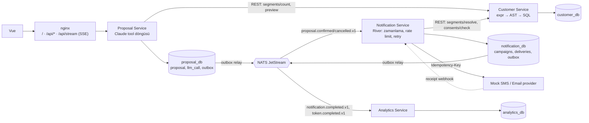

# Araştırma: THOUGHTS.md ve açık konular

> **Durum:** Araştırma bulguları, karar değil. CLAUDE.md Kural 1 gereği her öneri koda geçmeden önce kullanıcıya sorulur; onaylananlar DECISIONS.md'ye girer.
> **Tarih:** 2026-10-27 · **Girdi:** [THOUGHTS.md](../../THOUGHTS.md), `potential schemas.png`, [DECISIONS.md](../../DECISIONS.md) açık konuları, [database-architecture.md](../database-architecture.md).
> **Yöntem:** Dört paralel araştırmacı (web + resmi dokümanlar; biri çalışan `customer_db` üzerinde salt-okunur sorgu yaptı). Raporlar aşağıdaki dosyalarda Türkçeye aktarıldı; çelişkiler bu sayfada uzlaştırıldı.

| Dosya | Kapsam |
|---|---|
| [01-delivery-pipeline.md](01-delivery-pipeline.md) | Kuyruk, olaylar/outbox, zamanlama sahipliği, rate limit, idempotency, retry, mock provider, metrikler |
| [02-segment-query-gql-mcp-dsl.md](02-segment-query-gql-mcp-dsl.md) | GraphQL, MCP, JS benzeri filtre dili, token verimliliği |
| [03-llm-agent-flow.md](03-llm-agent-flow.md) | Model, yapılandırılmış çıktı, doğrulama, SMS/HTML, enjeksiyon, mock LLM, teklif durumu, bütçe |
| [04-data-platform.md](04-data-platform.md) | Migration, servisler arası iletişim, SSE, Türkçe şehir eşleşmesi, seed ölçekleme, nginx, p95 |

## Sonradan verilen kararlar (2026-10-27)

Kullanıcı bu araştırmadan sonra aşağıdakileri karara bağladı. Araştırma dosyaları olduğu gibi bırakıldı; çelişen yerlerde **DECISIONS.md geçerlidir**.

| Karar | Araştırmadan farkı |
|---|---|
| [D-006](../../DECISIONS.md#d-006-tüm-servisler-arası-mesajlaşma-iş-kuyruğu-ve-zamanlama-nats-jetstream-yayın-transactional-outbox-ile): tüm mesajlaşma, iş kuyruğu ve zamanlama NATS JetStream; outbox ile yayın | River **kullanılmıyor**. Zamanlama ve iptal NATS üzerinden; iptal, tetiklenme anında durum kontrolüyle. |
| [D-007](../../DECISIONS.md#d-007-customer-service-graphql-gqlgen-llm-js-benzeri-dsl-yazar-proposal-graphqle-çevirir-mcp-yok): Customer GraphQL (gqlgen), DSL → GraphQL çevirisi Proposal'da, MCP yok | Araştırma DSL'i Customer'da SQL'e derlemeyi ve GraphQL'i isteğe bağlı tutmayı önermişti. GraphQL artık ana arayüz; erişilebilirlik koşulu Customer resolver'ında. |
| [D-008](../../DECISIONS.md#d-008-alıcı-verisi-zamanlamada-nats-snapshotıyla-taşınır-izin-segment-sorgusunda-baştan-uygulanır) (yerini aldı → D-010, D-011): alıcı snapshot'ı NATS ile, izin sorguda baştan | Gönderim anında izin kontrolü, `consents/check` ve `consent.changed` **yok**. Notification → Customer senkron çağrısı yok; REST uç noktaları (Araştırma 4 §2) geçersiz. |
| [D-010](../../DECISIONS.md#d-010-kanal-planı-ayrı-onay-adımı-snapshot-kişi-başına-atanmış-kanalı-taşır): kanal planı ayrı onay adımı, kişi başına atanmış kanal | Araştırmada yoktu; THOUGHTS §5 için tasarlandı. |
| [D-011](../../DECISIONS.md#d-011-gönderim-anında-graphql-ile-batch-izin-kontrolü-circuit-breaker-ile-fail-closed): gönderimde GraphQL ile batch izin kontrolü, circuit breaker, `updateConsent` mutation | Araştırma 1'in "izin gönderim anında kontrol edilir" önerisi GraphQL üzerinden geri geldi; `consent.changed` olayları yok. |
| [D-009](../../DECISIONS.md#d-009-içerik-ve-zamanlama-alıcının-diline-göre-tüm-diller-onaylanmadan-teklif-onaylanmaz): dil başına teklif ve zamanlama, tüm diller onaylanmadan onay yok | Araştırmada yoktu; teklif durum makinesi (Araştırma 3 §9) varyant düzeyine iner. |
| [D-017](../../DECISIONS.md#d-017-seed-zaman-damgaları-yüklemede-bugüne-kaydırılır): seed zaman damgaları yüklemede bugüne kaydırılır | Araştırmada yoktu. |
| [D-018](../../DECISIONS.md#d-018-dört-servis-ve-mock-provider-her-biri-ayrı-konteyner): dört servis + mock provider, Analytics dahil | Kesme sırasındaki "Analytics tüketicisi → ayrı analytics DB" adımları geçersiz; Analytics baştan kurulur. |
| [D-019](../../DECISIONS.md#d-019-proposal_db-notification_db-analytics_db-rol-ve-boş-db-initdbde-açılır): `proposal_db`, `notification_db`, `analytics_db` | Uzlaştırma 5'teki diyagram adları seçildi; tasarım belgesindeki `campaign_db` / `delivery_db` geçersiz. |
| [D-024](../../DECISIONS.md#d-024-nats-düzeni-dört-stream-teslimat-başına-ileti-kanal-başına-100s-limiter-nak-ile-retry): dört NATS stream'i, teslimat başına `SEND` iletisi, kanal başına `x/time/rate` | River işleri ve River üzerinden ölçülen kuyruk derinliği geçersiz; retry NATS `NakWithDelay` ve `MaxDeliver` ile. |

## Diyagramdaki "Technical Decisions" sorularına cevaplar

| Soru | Bulgu | Ayrıntı |
|---|---|---|
| **GQL with MCP viable for customer DB custom filters?** | Uygulanabilir ama bu yapım için önerilmez. Claude API MCP connector herkese açık bir `https://` sunucu ister (docker-compose demosunda müşteri ambarını dışarı açmak demek) ve mock LLM ile test edilemez. GraphQL-MCP köprüleri modele serbest sorgu verir. Önerilen: Proposal'ın tanımladığı istemci tarafı tool + Customer Service'te derlenen filtre dili. GraphQL zaman kalırsa aynı derleyicinin ikinci ön yüzü. | [02 §1–2](02-segment-query-gql-mcp-dsl.md#1-mcp-doğru-köprü-mü) |
| **JS-like DSL that compiles to GQL JSON?** | Fikir doğru, hedef değişsin: DSL GraphQL'e değil, **kanonik kural AST'sine ve oradan doğrudan parametreli SQL'e** derlensin. `expr-lang/expr` ayrıştırır ve tip denetler, hiç çalıştırmaz. Çıktı token'ı JSON AST'nin ~⅓'ü, GraphQL'in ~¼'ü. | [02 §3–4](02-segment-query-gql-mcp-dsl.md#3-js-benzeri-ifade-dili) |
| **Proposal mı, Notification mı zamanlamanın sahibi?** | **Notification.** Rate limit, gönderim anı izin kontrolü, retry ve iptal yarışları orada. Proposal `send_at`'lı `proposal.confirmed.v1` yayınlar; Notification River `ScheduledAt` ile zamanlar, iptalde `JobCancel` + claim adımında durum kontrolü. | [01 §5](01-delivery-pipeline.md#5-zamanlama-sahibi-ve-iptal) |
| **Event-driven mi cron mu?** | Event-driven: servis DB'lerinde transactional outbox → NATS JetStream; Notification içinde zamanlanmış işler River ile (fiilen DB üzerinde poller, ama transactional ve iptal edilebilir). Saf cron gereksiz. | [01 §8](01-delivery-pipeline.md#8-olay-altyapısı-bir-haftalık-plan) |
| **Inter-service gRPC mi, bir haftaya fazla borç mu?** | Bir hafta için fazla. `buf` + codegen + özyinelemeli AST'nin protobuf'ta `oneof`/`Struct` ile modellenmesi gerekir; birkaç bin satırda kazanç küçük. **REST/JSON**, ince handler'larla; sonradan connect-go'ya geçiş ucuz. | [04 §2](04-data-platform.md#2-servisler-arası-iletişim) |
| **Analytics: tıklama oranı, CPM, token maliyeti?** | Token maliyeti kesin gösterilebilir: deneme başına `llm_call` satırı (girdi/çıktı/önbellek token'ları, model) → `token.completed.v1`. Teslim/açılma/tıklama `notification.completed.v1` ve receipt webhook'larından. Kısa URL tıklama proxy'si (THOUGHTS §10) araştırılmadı; bonus. Süre kısalırsa ilk kesilecek parçalardan biri. | [03 §9](03-llm-agent-flow.md#9-çok-adımlı-insan-onaylı-akış-thoughts-18), [01 §8](01-delivery-pipeline.md#8-olay-altyapısı-bir-haftalık-plan) |

THOUGHTS §2'deki iki seçenek için sonuç: **2.2'nin taşıma biçimi (sıradan tool, sunucu yürütür) + 2.1'in filtre dili** melezi. 2.3'teki erişilebilirlik koşulu derleyicide, kullanıcı ağacının dışında zorunlu olarak eklenir:

```sql
account_status = 'active' AND (
  (email IS NOT NULL AND email_opt_in AND NOT email_bounced)
  OR (phone_e164 IS NOT NULL AND sms_opt_in))
```

## Önerilen mimari (diyagrama göre)



Diyagramdan farklar: Customer Service'te GraphQL isteğe bağlı; Proposal → Customer arasında MCP yok; "Message Queue" somut olarak NATS JetStream; Notification içinde ayrıca River; tüm canlı durum SSE.

## Çelişkiler ve uzlaştırma

1. **Filtre biçimi: DSL string mi, JSON AST mi?** Araştırma 2 DSL string, Araştırma 3 sabit derinlikli JSON AST önerdi. İkisi de sunucuda beyaz listeli derlemede ve strict yapılandırılmış çıktının özyinelemeli şema desteklemediğinde hemfikir.
   **Uzlaştırma önerisi:** Claude, strict bir tool'un tek alanı olarak DSL string yazar (strict şemaya sorunsuz sığar, ~3 kat daha az çıktı token'ı, konum bilgili hata mesajları). Customer Service bunu kanonik JSON AST'ye çevirir ve teklif kaydında ikisi birlikte saklanır. expr'in AST'si sorun çıkarırsa yedek plan Araştırma 3'teki sabit derinlikli JSON şeması.
2. **Türkçe küçültme:** Araştırma 3 `cases.Lower(language.Turkish)` önerdi; Araştırma 4 bunun "Istanbul" için `ıstanbul` ürettiğini Go'da gösterdi. **Geçerli olan Araştırma 4:** kapalı şehir sözlüğü + `ı İ I → i` kanonik anahtar.
3. **İzin kontrolü nerede?** Araştırma 1 claim adımında, Araştırma 4 customer service'te tek doğruluk kaynağı diyor. **Uzlaştırma:** Notification, claim batch'inden hemen önce customer service'in `POST /v1/consents/check` uç noktasını çağırır; izin bayrağı `notification_db`'ye kopyalanmaz.
4. **Ayrı salt-okuma rolü / PII'siz görünüm:** Araştırma 2 ve 3 önerdi. Kullanıcı D-003'te ayrı rolü şimdilik istemedi. Görünüm gerekiyorsa `customer_svc` altında açılır; yeni rol ayrı bir karar.
5. **Veritabanı adları:** [database-architecture.md](../database-architecture.md) `campaign_db` ve `delivery_db`'yi planlıyor; diyagram Proposal / Notification / Analytic DB diyor. Araştırma diyagramın adlarını kullandı. Kabul edilirse tasarım belgesi güncellenmeli.

## Mevcut belgelerde düzeltilmesi gerekenler

- **Türkçe şehir eşleşmesi:** tasarım belgesi "İstanbul / istanbul eşleşmez" varsayıyordu. Alpine/musl imajında `ILIKE` İ için eşleşiyor, noktasız ı için eşleşmiyor ve bu davranış imaja bağlı. Segment doğrulaması zaten collation'a dayanmamalı ([04 §4](04-data-platform.md#4-türkçe-büyükküçük-harf-duyarsız-şehir-eşleşmesi)).
- **SMS 160 karakter:** Türkçe metin ç, ş, ğ, ı, İ içerdiği anda UCS-2'ye geçer; tek SMS 70, birleştirilmişte segment başına 67 karakter. "160 karakter" kuralı Türkçede genelde **3 segment** demek; bütçe hesabını doğrudan etkiler ([03 §5](03-llm-agent-flow.md#5-sms-uzunluğu-türkçe-neredeyse-her-zaman-ucs-2)).
- **Model API'si:** 5.x modellerinde `temperature` ve prefill 400 döner; Sonnet 5.5'te zorlanmış `tool_choice` desteklenmez. Go SDK v2'ye geçti (`/v2` modül yolu) ([03 §1–2](03-llm-agent-flow.md#1-model-seçimi-d)).

## Bir haftalık yapım sırası ve kesme sırası

1. Customer Service: katalog, `segments/count|preview|resolve`, `consents/check`; expr → AST → SQL derleyicisi, erişilebilirlik koşulu, sınırlar, Türkçe şehir anahtarı.
2. Proposal Service: Claude tool döngüsü, teklif ve `llm_call` kayıtları, onarım döngüsü (en fazla 3 deneme), SSE ilerleme akışı, outbox.
3. Notification Service: NATS tüketicisi, River zamanlama, `deliveries` durum makinesi, kanal limiter'ları, retry; mock provider (seed'li hata, kendi 429'u, idempotency yeniden oynatma).
4. Testler: mock LLM (senaryolu sahte + `httptest` Messages sunucusu), örnek brief için altın SQL (33 kişi), "iki kez gitmez" ve 429 testleri.
5. Vue: sohbet terminali, teklif onay/red, kanal kapsaması, SMS/HTML önizleme, zamanlama, canlı durum.
6. Zaman kalırsa: Analytics tüketicisi, receipt webhook'ları, gqlgen cephesi, tıklama proxy'si.

**Kesme sırası:** MCP → GraphQL → tıklama proxy'si → webhook receipt → Analytics tüketicisi → ayrı analytics DB.
**Asla kesilmeyenler:** beyaz listeli derleyici, erişilebilirlik koşulu, outbox + idempotent tüketici, `deliveries` unique kısıtı, mock LLM testleri.

## Kullanıcı kararı bekleyen konular

| Konu | Önerilen | Durum |
|---|---|---|
| Ajanın müşteri verisine erişimi | İstemci tarafı tool + DSL | **Karar: D-007** (GraphQL + DSL, MCP yok) |
| Servisler arası iletişim | REST/JSON | **Karar: D-006, D-007, D-008** (NATS + GraphQL) |
| Olay altyapısı | Outbox + NATS JetStream | **Karar: D-006** |
| İş kuyruğu ve zamanlama | River, sahibi Notification | **Karar: D-006** (NATS; sahibi Notification) |
| İçerik dili | — | **Karar: D-009** |
| Canlı durum | SSE (04 §3) | **Karar: D-013** (SSE; istek/yanıt REST) |
| Model | Sonnet 5.5 (+ Haiku 5.5 ön eleme) (03 §1) | **Karar: D-026**; çıktı yöntemi D-027 |
| SMS uzunluk politikası | En kötü durumda 160 karakter + segment/maliyet gösterimi (03 §5) | **Karar: D-028** |
| HTML email | Yuvalı şablon (03 §10) | Açık |
| Bütçe anlamı | Kampanya harcama tavanı + ajan token tavanı (03 §9) | Açık |
| LLM kataloğundaki hassas alanlar | `sex`, `age_years`, `yearly_salary_gbp`, `vehicle_*` dahil mi? (02) | **Karar: D-042** (kişisel olmayan tüm alanlar dahil) |
| Migration aracı | goose + sqlc + pgx (04 §1) | **Karar: D-020** |
| Seed ölçeği | `STUB_SCALE=3` (04 §5) | Açık |
